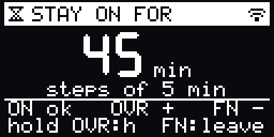
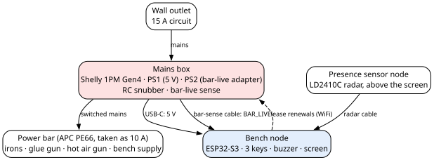
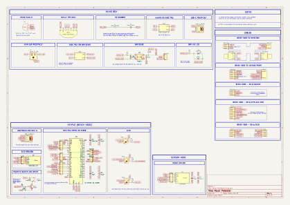
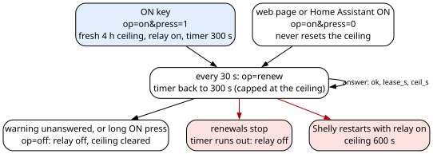

# Deadman Power Protector

A dead man's switch for the workshop/bench top power bar: it manages the soldering iron, glue gun and other 
I'll-burn-your-house-down hazards you keep forgetting to turn off when you move away of the bench.

The Deadman Power Protector turns a workshop power bar off when you leave the bench (after a programmable delay, of course).
A Shelly 1PM Gen4 relay in a mains box switches the bar. A bench node (an ESP32-S3 with three keys, a buzzer and a small OLED screen)
watches for you with an LD2410C radar and warns you before every automatic cut. You press a key and the countdown restarts.
It is for anyone whose hot, dangerous tools share one power bar and who has, at least an uncomfortable amount of time, walked 
away with the iron still on.

**Release version 1** (2026-11-12) · hardware revision A · firmware `v.1.0.20261113T000224Z`

## The device

It's a dead man's switch, hence the name. The bench node doesn't tell the Shelly "turn off": it keeps telling it "stay
on for 5 more minutes", every 30 seconds. That's the lease part. If the bench node dies, gets unplugged, crashes, or the
WiFi goes for a walk, the renewals stop and the Shelly cuts the bar by its own timer. 

With the default settings: 15 minutes without seeing you starts a 5-minute warning (screen and buzzer), any key answers
it, and an unanswered warning cuts the bar. Going to the bathroom for 2 minutes cuts nothing. There's a programmable 4 
hours ceiling before an automatic cut. If there are no press of the ON key when the bench node warns, the Shelly cuts. 
A second, independent sense line in the mains box reads whether the bar is really live, so the Shelly isn't trusted blindly. 
If the Shelly says off and the bar is still live, the bench node sounds an alarm (just in case the Shelly shits the bed).

The bench node's screen has a pig. He's Gilbert. Why a pig? Because I love pigs. You don't like pigs? What's wrong with you?
With the Shelly off, Gilbert chills out. With the Shelly on (and with you at the bench), Gilbert works. If you go away from 
the radar, Gilbert gets more and more worried until the warning takes over. Zero safety value but absolutely necessary.

| | | | | | |
|:---:|:---:|:---:|:---:|:---:|:---:|
| <br>Coffee | <br>Asleep | <br>Bath | <br>Meditate | <br>Reading | <br>Music |
| <br>Butterfly | <br>Anvil | <br>Soldering | <br>Welding | <br>Tinker | <br>3D printer |
| <br>Leather | <br>Sunglasses | <br>Looking | <br>Looking harder | <br>Worried | <br>Panic |

And the screens that actually matter:

| | | |
|:---:|:---:|:---:|
| <br>At work, bar on | <br>Nobody seen: the warning | <br>Alarm: relay stuck on |
| <br>Stay-on menu | <br>Bar off | <br>Radar view |

Each one runs for about 10 seconds here; on the device a pig scene stays 20 seconds before the next one.

## Specifications

- **Switching:** Shelly 1PM Gen4 smart relay in a mains box, 120 V; every mains part sized for 15 A continuous
- **Microcontroller:** ESP32-S3, the bench node
- **Presence:** LD2410C radar; optionally, a camera check through Frigate
- **Display:** SSD1306 OLED module
- **Input:** three keys with LEDs: ON, OVERRIDE (stay on for a set time) and an FN key
- **Sound:** magnetic passive buzzer
- **Power:** the mains box plugs into the wall and feeds the bench node 5 V over a USB-C cable
- **Enclosures:** your choice; the Hardware Bible lists what the mains box's enclosure must do.
- **Firmware:** absence cut with a warning, a hold for long jobs, a 4-hour ceiling enforced by the Shelly itself,
  alarms for a stuck relay or a lost link, a web page, Home Assistant over MQTT, updates over WiFi.

## What is in this repository

| Path | What is there | Open first |
|---|---|---|
| [`hardware/`](hardware/) | The schematic (KiCad 9 and PDF) and the bill of materials | [`Power Protector - Schematic.pdf`](hardware/KiCad/Power%20Protector%20-%20Schematic.pdf) |
| [`firmware/`](firmware/) | The bench node firmware (PlatformIO), its field tests, and the Shelly's lease script | [`pins.h`](firmware/bench-node/firmware/src/pins.h) |
| [`docs/`](docs/) | The Hardware Bible and the Firmware Gospel, as PDF and Markdown, and their figures | [`Deadman Power Protector - Hardware Bible.pdf`](docs/Deadman%20Power%20Protector%20-%20Hardware%20Bible.pdf) |
| [`llms.txt`](llms.txt) | A map of this repository for an LLM | |
| `LICENSE-*` | The three licences, also in [`LICENSES/`](LICENSES/) | |

## Build it

1. Read the [Hardware Bible (PDF)](docs/Deadman%20Power%20Protector%20-%20Hardware%20Bible.pdf), safety chapter first:
   the mains box carries mains whenever it is plugged in, bar off or not.
2. Gather the parts in the [bill of materials](hardware/Deadman%20-%20BoM.csv), by enclosure; the Hardware Bible's
   parts table gives each part's values and ratings.
3. Build the mains box, the bench node and the sensor node from the
   [schematic](hardware/KiCad/Power%20Protector%20-%20Schematic.pdf).
4. Make the cables from the cable drawings in the Hardware Bible (also in [`docs/figures/`](docs/figures/)).
5. Configure the Shelly and install its lease script, as the
   [Firmware Gospel (PDF)](docs/Deadman%20Power%20Protector%20-%20Firmware%20Gospel.pdf) says.
6. Fill in the bench node's secrets file, set your time zone, and flash it.

## Flash the firmware

In a git clone of this repository (the version stamp reads git):

```sh
cd firmware/bench-node/firmware
cp include/secrets.example.h include/secrets.h   # then fill in its six fields
pio run -t upload
```

After the first flash, updates go over WiFi. The
[Firmware Gospel (PDF)](docs/Deadman%20Power%20Protector%20-%20Firmware%20Gospel.pdf), "How to flash it and first boot",
gives the details, and "The Shelly and its configuration" covers the lease script.

> [!WARNING]
> The field tests in `firmware/bench-node/fieldtest/` switch the real power bar and rewrite the Shelly's script. Copy
> `config.example.json` to `config.json` and put in your own devices' addresses and MACs first, as the Firmware
> Gospel's "Field tests" says.

## Documentation

| Book | For a human | For an LLM |
|---|---|---|
| Hardware Bible | [`Deadman Power Protector - Hardware Bible.pdf`](docs/Deadman%20Power%20Protector%20-%20Hardware%20Bible.pdf) | [`hardware-bible.md`](docs/hardware-bible.md) |
| Firmware Gospel | [`Deadman Power Protector - Firmware Gospel.pdf`](docs/Deadman%20Power%20Protector%20-%20Firmware%20Gospel.pdf) | [`firmware-gospel.md`](docs/firmware-gospel.md) |

An LLM agent can start from [`llms.txt`](llms.txt).

<details>
<summary>More pictures</summary>







</details>

## Help

Found an error, or stuck on a step? Open an issue in this repository's [GitHub issues](../../issues).

## Licence

| Part | Licence |
|---|---|
| Hardware design (KiCad files) | [CERN-OHL-S-2.0](LICENSE-CERN-OHL-S-2.0) |
| Firmware (everything in `firmware/`, the Shelly script included) | [GPL-3.0-or-later](LICENSE-GPL-3.0-or-later) |
| Documents (`docs/`, the READMEs, `llms.txt`) | [CC-BY-SA-4.0](LICENSE-CC-BY-SA-4.0) |

© 2026 Zeroshin.
