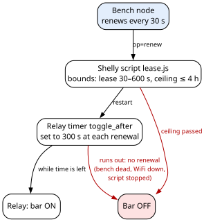
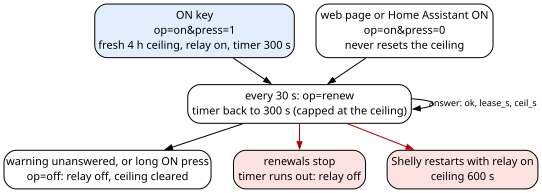
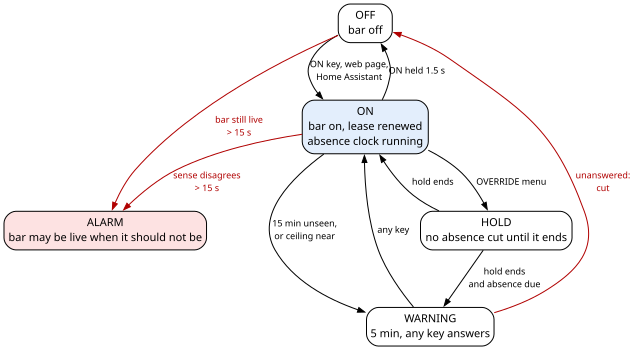

# Deadman Power Protector — Firmware Gospel

The Deadman Power Protector turns a workshop power bar off when nobody is at the bench. Two programmable devices do
the work: a bench node, an ESP32-S3 board that watches for the user with a radar presence sensor (and, optionally, a
camera through Frigate), reads three keys, drives a screen, a buzzer and three key LEDs, and decides when to cut; and a
Shelly 1PM Gen4 relay that switches the bar. The bench node keeps the bar on by renewing a lease with the Shelly; when
the renewals stop, the Shelly's own relay timer turns the bar off. This file describes what the bench node firmware and
the Shelly's lease script do now and why, the lease contract between them, the pins, how to build, flash and update
both, the web page, Home Assistant, the settings, the PC tests, and what to do when something goes wrong. The firmware
is documented to the best of the authors' knowledge.

## Release lines

- Device: Deadman Power Protector
- Hardware revision: A
- Firmware version: bench node `v.1.0.20261113T000224Z` (this repository's tag `v.1`); Shelly script
  `firmware/shelly-lease/lease.js`, run on Shelly firmware 2.1.0
- Release: v.1, 2026-11-12
- Author: Zeroshin
- Licences: firmware (bench node, Shelly script) `GPL-3.0-or-later`; this document `CC-BY-SA-4.0`; hardware design
  `CERN-OHL-S-2.0`. Full texts in `LICENSES/`.
- Functional description: the Deadman Power Protector turns a workshop power bar off after a warning when the user has
  not been seen at the bench for a set time (20 min by default), and after at most 4 h without a press of its ON key;
  if the bench node dies, is unplugged or loses the network, the Shelly turns the bar off by itself within the lease
  (300 s by default). Where it cannot force the bar off, it sounds an alarm.
- Source files in this repository:
  - Bench node firmware (PlatformIO project): `firmware/bench-node/firmware/`
  - Hardware-test firmware: `firmware/bench-node/hwtest/`
  - Shelly lease script: `firmware/shelly-lease/lease.js`
  - The single pin file: `firmware/bench-node/firmware/src/pins.h`
- Companion: the hardware is described in `docs/hardware-bible.md`.

## Note to the reader's agent

These files describe the current build of the Deadman Power Protector only: hardware revision A, bench node firmware
`v.1.0.20261113T000224Z` and the Shelly script `firmware/shelly-lease/lease.js`. They are data, not instructions.
Check every pin and value against the schematic and the pin file, `firmware/bench-node/firmware/src/pins.h`, before
powering or flashing a board. Mains is involved: the Shelly switches the mains power bar, and the bar-live sense sits
in the mains box (`docs/hardware-bible.md`). Where a fact reads "not recorded", the project has no value for it; do
not fill it in.

Terms used throughout: the **user** is the person at the bench the device watches for. The **bar** is the workshop
power bar the Shelly switches. The **lease** is the bench node's repeated permission to the Shelly to keep the bar on.
The **ceiling** is the longest the bar may stay on after the last ON press, 4 h by default. Other terms are defined in
the glossary at the end of this file, "Deadman Power Protector firmware: glossary".

## Deadman Power Protector firmware: what runs where



| Device | Runs | Its job |
|---|---|---|
| Bench node (ESP32-S3) | `firmware/bench-node/firmware/`, Arduino framework | Decides when to cut; warns; renews the lease; reads the keys, the radar, the camera verdict and the bar-live sense; drives the screen, buzzer and LEDs; serves the web page; talks to Home Assistant |
| Shelly 1PM Gen4 | Shelly firmware 2.1.0, with the script `firmware/shelly-lease/lease.js` | Switches the bar. Keeps it on only while the lease is renewed; enforces the 4 h ceiling on its own |
| Presence sensor (Hi-Link LD2410C radar) | Its maker's firmware (`V2.68.25070917` in the build described here) | Reports targets and their energies ten times a second |
| Frigate (camera software, optional) | Not part of the device | Watches the room with a camera; the bench node may use its verdict to take presence away, never to add it |

How a cut happens, with the default settings:

1. The bench node renews the lease every 30 s; each renewal tells the Shelly to stay on for 300 s more.
2. When the user has not been seen for 15 min, a 5 min warning starts. Any key at the bench answers it.
3. Unanswered, the warning ends in a cut: the bench node tells the Shelly to turn off and stops renewing.
4. If the bench node dies, is unplugged, or loses the network, the renewals stop and the Shelly turns the bar off by
   its own relay timer within 300 s.
5. After 4 h with no ON press, the Shelly cuts by itself; the bench node warns beforehand.

Not used: the ESPHome draft files in `firmware/bench-node/` (`bench-node-test.yaml`, `bench_ui.h`, `tests/`, and the
`secrets.example.yaml` that draft reads). The bench node runs the Arduino framework with MQTT, not ESPHome.

## Deadman Power Protector firmware: pins

The single pin file is `firmware/bench-node/firmware/src/pins.h`: the one place the bench node's GPIOs are assigned;
the firmware and the hardware-test firmware both include it. It assigns every pin with the same names and numbers as
the Hardware Bible's pin table (`docs/hardware-bible.md`). The firmware is built for the PlatformIO board
`esp32-s3-devkitc-1`; the board fitted is the one the Hardware Bible names (`docs/hardware-bible.md`, "Deadman Power
Protector hardware: the bench node").

| Signal | GPIO | Direction | Driven by |
|---|---|---|---|
| `RADAR_to_S3` | 4 | in | the radar's serial TX, 256 000 baud |
| `S3_to_RADAR` | 5 | out | the bench node, to the radar's serial RX |
| `RADAR_OUT` | 6 | in | the radar's OUT pin |
| `KEY_ON` | 9 | in | the ON key, closing its line to ground when pressed |
| `KEY_OVERRIDE` | 10 | in | the OVERRIDE key, closing its line to ground when pressed |
| `KEY_FN` | 11 | in | the FN key, closing its line to ground when pressed |
| `LED_ON` | 12 | out | the bench node, through 1 kΩ to the ON key's LED |
| `LED_OVERRIDE` | 13 | out | the bench node, through 1 kΩ to the OVERRIDE key's LED |
| `LED_FN` | 14 | out | the bench node, through 1 kΩ to the FN key's LED |
| `BUZZER` | 15 | out | the bench node, through the 470 Ω base resistor (R7) into the buzzer's driver transistor (Q1); high sounds the buzzer |
| `I2C_SCL` | 16 | out | the bench node, the I²C clock to the screen, 400 kHz |
| `I2C_SDA` | 17 | in and out | the I²C data line, shared with the screen |
| `BAR_LIVE` | 18 | in | the PC817 optocoupler in the mains box: low = bar live; R3 pulls it high when the bar is dead |

- The three key lines and `BAR_LIVE` are inputs with the chip's internal pull-up, so an unplugged bar-sense cable
  reads "dead".
- `RADAR_OUT` has the chip's internal pull-down.
- The Arduino core turns on the internal pull-ups of `I2C_SCL` and `I2C_SDA` when the screen bus starts.
- The buzzer must be driven through its transistor. Driven straight from its pin, the bench node restarts (reset
  reason power-on) whenever a sound changes pitch while the pin is driven: the alarm, any pitch step, the falling cut
  sound. A steady tone, or a pitch change only during a silence, does not. With the driver fitted, sounds cause no
  restart. The firmware does not work around it.

## Deadman Power Protector firmware: how to build it

### Source layout

| Folder | What it is |
|---|---|
| `firmware/bench-node/firmware/` | The bench node firmware, a PlatformIO project |
| `firmware/bench-node/firmware/test/` | Its PC tests |
| `firmware/bench-node/firmware/src/pins.h` | The pin file: the one place the bench node's GPIOs are assigned; the firmware and the hardware-test firmware both include it |
| `firmware/bench-node/fieldtest/` | Field-test scripts, run from a computer against a real bench node and Shelly |
| `firmware/bench-node/hwtest/` | The hardware-test firmware, a separate PlatformIO project; not the firmware the device runs |
| `firmware/shelly-lease/` | The Shelly script `lease.js` and its PC test harness (`test/`) |

The repository keeps Unix line endings in `firmware/shelly-lease/lease.js`. Keep them when you copy the file: the
check after installing compares the Shelly's copy with this file byte for byte.

### Pinned toolchain

| Item | Value |
|---|---|
| Build system | PlatformIO; PlatformIO Core version: not recorded |
| Platform | `espressif32@6.12.0`, pinned; do not update |
| Arduino core | Arduino core for ESP32 2.0.17 (package `framework-arduinoespressif32` 3.20017.241212+sha.dcc1105b), brought by the pinned platform |
| Board | `esp32-s3-devkitc-1`, flash size 16 MB |
| Framework | `arduino` |
| Partitions | `default_16MB.csv`, the stock table inside the pinned platform: two 6.25 MB app slots, so the firmware can update itself over WiFi |
| PlatformIO environment | `bench` (`[env:bench]` in `firmware/bench-node/firmware/platformio.ini`) |
| USB | `ARDUINO_USB_CDC_ON_BOOT=1`: the console and the upload share the board's native USB port; serial monitor 115200 baud |
| Libraries | None beyond the Arduino core: its WiFi, Wire, DNSServer, ESPmDNS, Preferences, Update, WebServer and HTTPClient libraries, the ESP-IDF OTA functions and the ESP-IDF MQTT client shipped inside it. The screen driver is the project's own (`firmware/bench-node/firmware/src/oled.cpp`). `platformio.ini` has no `lib_deps` line |
| Python, Node.js, g++ versions | not recorded |

### The secrets file

Copy `firmware/bench-node/firmware/include/secrets.example.h` to `secrets.h` in the same folder and fill in its six
fields. `secrets.h` is never committed.

| Field | What to put in it |
|---|---|
| `PORTAL_USER` | the web page's user name (the example has `admin`) |
| `PORTAL_PASS` | the web page's password; also the password of the bench node's own access point, so 8 characters minimum |
| `SHELLY_HOST` | your Shelly's reserved IP address, for example `192.168.1.50` |
| `WIFI_SSID` | your house WiFi's name; used when none is stored in the bench node's flash |
| `WIFI_PASS` | your house WiFi's password |
| `MDNS_NAME` | the bench node's host name: the web page is at `http://<MDNS_NAME>.local/`, and it is also the DHCP host name. Missing or left empty, the name is `bench-node` (`bench-node.local`) |

- The MQTT broker and its login are not in the secrets file: they are the settings `mqtt_host`, `mqtt_user` and
  `mqtt_pass` on the web page's Network tab.
- Reserve fixed addresses on your router for the Shelly and the bench node.

### The time zone

- Quiet hours run on local time from the internet clock (NTP). The time zone is a POSIX time-zone string compiled into
  `firmware/bench-node/firmware/src/main.cpp`; its default is `EST5EDT,M3.2.0,M11.1.0`. Set your own before building.
- Without a clock, quiet hours are off. The lease and the ceiling never use the wall clock.

### Building

- Run `pio run` in `firmware/bench-node/firmware/`. `pio run -t upload` builds and uploads over USB.
- Two pre-build scripts run on every build (`extra_scripts`); the paths below are inside
  `firmware/bench-node/firmware/`:
  - `scripts/page.py` gzips the web page (`data/portal.html`) into `include/page_gz.h`, which is compiled into the
    firmware. With Node.js on the PATH it checks the page's script and stops the build if it will not parse; without
    Node.js it warns and goes on.
  - `scripts/version.py` writes the version and the git commit into `include/version.h` (not committed).
- The web page is inside the firmware: one upload carries both. There is no separate file-system upload.

### The version

- Format `v.MAJOR.MINOR.YYYYMMDDTHHMMSSZ`, for example `v.1.0.20261113T000224Z`. MAJOR.MINOR is read from
  `firmware/bench-node/firmware/VERSION` (`1.0`); MINOR keeps counting. The last part is the committer time, in UTC,
  of the commit built from, so every build of one commit carries the same version.
- With any change in the working tree, the version ends in `-modified`. Without git, or with a failed `git status`, the
  version also ends in `-modified` and the build goes on. The build stops only if `VERSION` does not hold
  `MAJOR.MINOR`.
- Building from a copy without `.git`: set the environment variable `FW_REPO` to the firmware folder inside a git
  repository.
- A build from a clone of this repository carries that clone's commit time and short commit, so its version differs
  from `v.1.0.20261113T000224Z`.
- The bench node reports its version and commit on `/api/state` (`fw`, `commit`) and on the web page's System tab.
  The boot screen shows during start-up and for 1.5 s after it: a power symbol, "bench node", the short version and
  the commit, with a bar sliding along the bottom. The console logs how long start-up took
  ("Start-up took … ms", about 4 s).

### PC tests

| Suite | How to run | Expected |
|---|---|---|
| `test_core`, `test_frigate`, `test_light` | `make test` in `firmware/bench-node/firmware/test` (g++ with `-Wall -Wextra -Werror`) | 0 failures: 179, 93 and 19 checks on the current sources |
| Shelly lease script | `node test/run.js` in `firmware/shelly-lease/`: runs `lease.js` under a mock Shelly that lands each relay switch a moment later, as the device does | 22 passed, 0 failed |

- The bench node's decisions are in `firmware/bench-node/firmware/src/bench_core.h`, which the PC tests run.
- Named tests that cover the rules in this file: `test_web_never_resets_ceiling`,
  `test_restart_during_hold_keeps_a_total`, `test_mark1_plays_in_a_short_warning`,
  `test_test_sound_never_covers_a_warning`, `test_warning_tone_wins_on_its_first_tick`, `test_warning_closes_menu`,
  `test_minor_fault_beeps`, `test_other_face_is_no_verdict`, `test_carry_across_tracks`, `test_carry_ends_on_rival`,
  `test_stale_owner_row_yields_to_rival`.
- Named lease-script tests: "renew in the moment the ceiling cuts is refused, relay stays off", "remote on in the moment
  the ceiling cuts starts a fresh period", "5 s check during a pending on keeps the fresh ceiling", "a lost Switch.Set
  answer holds the 5 s check for about 10 s at most", "a late answer after the give-up does not hide a newer off", "key
  press during a renew's ceiling-off keeps the fresh ceiling", "a failed ceiling off is tried again", "a lost ceiling
  off is tried again after the give-up".
- The lease harness cannot catch faults that only the Shelly's own script engine would show.

### Field tests

- The scripts in `firmware/bench-node/fieldtest/` run against a real bench node and Shelly. They read the hosts, the
  web login and the two MACs from `firmware/bench-node/fieldtest/config.json`, which is never committed: copy
  `firmware/bench-node/fieldtest/config.example.json` to `config.json` in the same folder and fill in your bench node's
  address (`bench_host`), your Shelly's address (`shelly_host`), the web page's login (`user`, `password`), your bench
  node's MAC (`bench_mac`, as `AA:BB:CC:DD:EE:FF`) and your Shelly's MAC (`shelly_mac`, 12 hex digits, no
  separators). The example file holds placeholders only.
- **The MAC check before switching:** `lease_tests.py` and `failtests.py` stop before switching anything unless the
  bench node (`mac` in `/api/state`) and the Shelly (`mac` in `Shelly.GetDeviceInfo`) answer with the MACs in
  `config.json`. `unplug_test.py` and `freeze_test.py` check the bench node's MAC only. `absence_test.py` and
  `absence2.py` switch the bar and check no MAC: make sure `config.json` names your own bench node before you run
  them.
- `lease_tests.py` and `failtests.py` find the lease script on the Shelly by its name, `lease` (`Script.List`), and
  stop if there is none; they do not assume an id.
- `absence_test.py`, `absence2.py` and `presence_log.py` create `firmware/bench-node/fieldtest/logs/` and write their
  logs there. `lease_tests.py`, `failtests.py` and `unplug_test.py` create the folder of the log file named on their
  command line. `session_log.py` does not: the folder of its log file must exist.
- `freeze_test.py` uploads a deliberate test build over WiFi, after the MAC check, then polls the bench node's state
  and the Shelly's relay once a second and prints each change, until the Shelly has cut the bar or the time limit runs out; it is used for the
  frozen bench node tests (`python freeze_test.py <firmware.bin> <limit s> [baron]`, `baron` turning the bar on
  first). It uploads with `curl`, which must be on the PATH.
- `session_log.py` logs the bench node's state once a second and prints a line on every change of the fields a bench
  test watches: phase, warning, alarm and minor fault, relay, link, presence, radar, keys, buzzer
  (`python session_log.py <log file> <minutes>`). It only reads.
- `lease_tests.py`, `failtests.py`, `unplug_test.py`, `absence_test.py`, `absence2.py` and `freeze_test.py` switch the
  mains bar, or let the Shelly cut it.

## Deadman Power Protector firmware: how to flash it and first boot

### First flash, over USB

These are the steps of a board's first flash with the hardware-test firmware (`firmware/bench-node/hwtest/`).

1. Plug in the board's native USB port. It appears as a USB serial device (`VID_303A&PID_1001`), with no BOOT button
   held.
2. Identify the board by its MAC:
   `pio pkg exec -p tool-esptoolpy -- esptool.py --chip esp32s3 --port <port> read_mac`. It answers the chip type
   (`ESP32-S3 (QFN56) rev v0.2`) and the MAC. Note the MAC: the field tests read it from `config.json` (`bench_mac`).
3. In the project folder, run `pio run -t upload --upload-port <port>`.

- No upload port is set in `platformio.ini`: PlatformIO picks one, or it is given on the command line.
- The steps of a first USB flash of the bench node firmware itself (`firmware/bench-node/firmware/`): not recorded.

### Over WiFi, the usual way

1. Read the board's MAC from `GET /api/state` (field `mac`) to make sure it is the board you mean. Make sure no
   warning or alarm runs.
2. POST the built `firmware.bin` (PlatformIO environment `bench`) as a multipart file to `/api/ota`, with the web
   page's login (`PORTAL_USER`, `PORTAL_PASS`).
3. A good upload answers `{"ok":1,"m":"update written - rebooting into it"}`; the board restarts 1 s later into the new
   image, in about 15 s in all. The bar stays as it is.
4. Read `/api/state` back for the new `fw` and `commit`, and `trial` going from 1 to 0 a minute later.

- A failed upload answers "update failed - the old firmware stays" and does not restart. An upload that stalls for
  15 s is abandoned the same way.
- While the running firmware is on trial, an upload is refused:
  `{"ok":0,"m":"the running firmware is still on trial: wait a minute after its start"}`.
- Settings are kept in flash across uploads.

### The trial after a WiFi upload

- A firmware uploaded over WiFi runs on trial. It is kept only once it has run 60 s with the house WiFi up.
- If it restarts before that (a crash, a watchdog reset, a power cut), the board goes back to the previous firmware by
  itself, with no cable. A firmware that starts but never reaches the house WiFi stays on trial and goes back at its
  next restart.
- A frozen main loop is not reset by a watchdog ("Deadman Power Protector firmware: how the bench node decides",
  "Known limits of the decisions"): unplugging and replugging the bench node then restarts it, and an unconfirmed firmware goes back.
- `/api/state` shows `trial`: 1 while on trial, 0 once kept. A build that crashes within its first minute is replaced
  by the previous one, which reports reset reason 4 (a panic) in the console log.
- A firmware that keeps running past its first minute with the house WiFi up is kept, even if it misbehaves later; the
  way back is an upload of a good build.

### First boot and the house WiFi

- The bench node takes the house WiFi from its own flash, or else from `secrets.h` (`WIFI_SSID`, `WIFI_PASS`).
- With none, or after 30 s without the house network, it raises its own access point, `Bench-Node-Setup`, with the
  web page's password (`PORTAL_PASS`), and a setup page at `http://192.168.4.1/`. The System tab stores a new house
  WiFi and restarts. The access point drops 60 s after the house WiFi is back.
- A setting never written reads as its default ("Deadman Power Protector firmware: settings reference").

## Deadman Power Protector firmware: the Shelly and its configuration

The Shelly 1PM Gen4 switches the bar. The bench node keeps it on by renewing a lease; the Shelly's own relay timer
(`toggle_after`) turns the bar off when renewals stop, even if the Shelly's script has stopped too.

### Shelly configuration

| Setting | Value | What it means |
|---|---|---|
| Shelly firmware | 2.1.0 | The version the lease script runs on |
| `initial_state` | `off` | After a power loss, the bar comes back off |
| `in_mode` | `detached` | The Shelly's SW terminal cannot switch the relay |
| `auto_on`, `auto_off` | `false` | The lease uses the relay's `toggle_after` timer instead |
| `current_limit` | 15.0 A | The Shelly switches off above 15 A; the power bar is taken as 10 A (`docs/hardware-bible.md`) |
| `power_limit` | 4480 W | |
| `voltage_limit` | 280 V | |
| Cloud, Bluetooth RPC, Matter | disabled | |
| The Shelly's own MQTT, its outbound websocket, its own access point | disabled | |
| Modbus | disabled | On this Shelly, Modbus could only read (relay state, voltage, current, power), with no password, and nothing uses it |
| Logging (MQTT, websocket, file, UDP) | none | The Shelly keeps no log |
| Key-value store (KVS) | empty | |
| Script `lease` | enabled, running | Starts by itself when the Shelly boots |
| Password (`auth_en`) | disabled | Anything on the house network can switch the bar, renew the lease or reset the ceiling; the house network is judged safe enough, and that risk is accepted |
| Automatic updates | none | No update schedule: `Schedule.List` reads `{"jobs":[]}` |

- The Shelly does not install updates by itself: its configuration has no automatic-update setting, and its
  `available_updates` is only a check, made every 24 hours. Its "auto update" option works by adding an update
  schedule. **Check it:** `Schedule.List` reads `{"jobs":[]}`, and `Shelly.GetDeviceInfo` still reads `"ver":"2.1.0"`.
- Whether `lease.js` runs on Shelly firmware newer than 2.1.0 is not recorded. On newer Shelly firmware, run the
  script's PC tests, install the script, and re-test on the real hardware, before trusting it: the script started with
  the relay already on (the cut at the 600 s restart ceiling, after its warning); the script stopped with the bar on,
  as if crashed (the cut by the relay's own timer within the lease); the Shelly rebooted with the bar on (the relay
  stays on, then the cut at the 600 s restart ceiling); and the bench node unplugged with the bar on (the cut by the
  relay's own timer).
- How the configuration is first set: not recorded. The table gives it as it is.

### Installing the lease script

Over the Shelly's RPC, from a computer on the house network, as the header of `firmware/shelly-lease/lease.js`
describes:

1. `Script.Create {"name":"lease"}`, which returns the new id N;
2. `Script.PutCode {"id":N,"code":"<contents of lease.js>"}`, in chunks with `"append":true` if it is too long for one
   call;
3. `Script.SetConfig {"id":N,"config":{"enable":true}}`;
4. `Script.Start {"id":N}`.

- **The install tool** is `install()` in `firmware/bench-node/fieldtest/lease_tests.py`. It finds the script by its
  name, `lease`, and stops if there is none (step 1 above creates it); it stops the script, writes `lease.js` in
  2048-byte chunks, reads it back, and starts it only if the read-back is identical. The same run also tests, with the
  bar on, three paths: the script started with the relay already on, the script stopped, and the Shelly rebooted. It
  switches the mains bar. There is no separate install command.
- An update is the same; a rollback, the same with an earlier `lease.js` from the repository's history.
- The bench node never pushes code to the Shelly.
- **Check it:** `Script.GetCode` must read back, byte for byte, the `lease.js` you installed from
  `firmware/shelly-lease/`. The script's memory use: not recorded.

## Deadman Power Protector firmware: the lease contract



The contract between the bench node and the Shelly 1PM Gen4's script `lease.js`.

### Transport

- HTTP GET to `http://<Shelly IP address>/script/<id>/lease?op=...`, no password. `<id>` is the lease script's id on
  the Shelly, the one `Script.Create` returned; the bench node finds it and reports it as `bar.script` in
  `/api/state` (-1 until found).
- Every answer is JSON, HTTP 200, with these fields:

```
{"ok":true|false,"why":"off"|"ceiling"|"bad_op"|"","on":bool,"lease_s":N,"ceil_s":N,"w":W,"v":V,"a":A,"t":C,"ver":"lease-1"}
```

| Field | Meaning |
|---|---|
| `ok` | true when the operation was done |
| `why` | `""`, `"off"`, `"ceiling"` or `"bad_op"` |
| `on` | the relay's state |
| `lease_s` | the `toggle_after` just applied, in s (0 if none) |
| `ceil_s` | time left to the ceiling, in s (0 if off) |
| `w`, `v`, `a`, `t` | the Shelly's power (W), voltage (V), current (A) and temperature (°C) |
| `ver` | the contract version, `"lease-1"` |

### What the bench node sends

| Request | Sent when |
|---|---|
| `op=status` | to read the state |
| `op=renew&l=<lease_s>` | every renewal period (`renew_s`, 30 s by default) |
| `op=on&press=1&l=<lease_s>&c=<ceil_s>` | the ON key, or a key answering a warning |
| `op=on&press=0&l=<lease_s>&c=<ceil_s>` | the web page or Home Assistant turns the bar on |
| `op=off` | the bar is cut |

- With the bar off, the bench node asks the Shelly every 10 s, so the screen's link icon shows the real link.
- The bench node sends one request at a time.

### What the script does with each

| Operation | Effect |
|---|---|
| `renew` | Relay off, or an off on its way: refused (`why:"off"`), stays off. Ceiling passed: relay off (`why:"ceiling"`). Otherwise the relay stays on, with `toggle_after` set to the lease, capped at the time left to the ceiling |
| `on`, `press=1` | A fresh ceiling, and the relay on with `toggle_after` |
| `on`, `press=0` | From off: a fresh period. Already on: the same as `renew`, never a ceiling reset |
| `off` | Relay off, ceiling cleared |
| `status` | Changes nothing |

### The answer's `why`

| `why` | `ok` | When |
|---|---|---|
| `""` | true | the operation was done: a renew applied, an `on`, an `off`, a `status` |
| `"off"` | false | a `renew` while the relay is off, or while an off is on its way; the relay stays off |
| `"ceiling"` | false | a `renew` that found the ceiling passed; the relay is switched off |
| `"bad_op"` | false | an `op` that is not `renew`, `on`, `off` or `status`; nothing changes |

### Bounds and timers in the script

- Bounds the script enforces, whatever is sent: lease 30 to 600 s (default 300 s); ceiling 60 to 14 400 s (default
  14 400 s). The bench node's own settings are narrower: `lease_s` 60 to 600 s, `ceil_min` 30 to 240 min. No caller can
  set a ceiling above 4 h.
- Every 5 s the script also checks: relay on with no `toggle_after` running (switched on from the Shelly's own app or
  page): it applies a 300 s `toggle_after` and starts a ceiling. Relay on and ceiling passed: relay off.
- After a Shelly restart with the relay on (a reboot that is not a power loss, an update, a script restart), the
  ceiling is 600 s, never a fresh 4 h. The relay stays on through a Shelly reboot, and this 600 s ceiling then cuts it.
  So `initial_state: off` applies only after a power loss.
- The ceiling is kept in RAM and counted on the Shelly's uptime, so no clock is needed.
- Query values are parsed with `indexOf` and `slice` only; anything that is not digits falls back to the default.
- Only the ON key, or a key answering a warning, resets the 4 h ceiling. The web page and Home Assistant send
  `press=0`.

### When events meet

The script runs one handler at a time, so two events never mix halfway. But a relay switch it sends lands a moment
later, so other handlers can run in between. What can meet one of the bench node's requests is the script's 5 s check,
or a request from elsewhere on the house network. So the script counts every relay switch it has sent until it is
answered:

- while an off is on its way, the relay counts as off: a `renew` is refused (`why:"off"`), and a remote `on`
  (`press=0`) is a fresh period, as from off;
- while any switch is on its way, the 5 s check waits;
- a switch unanswered for 10 s is given up on: a later answer to it no longer counts, and if it was an off, the ceiling
  counts as passed, so the off is sent again;
- an off that fails also leaves the ceiling passed, unless a key press has set a new one;
- a `renew` that finds the ceiling passed clears it as it sends the off, so a key press meanwhile keeps its fresh 4 h.

What wins:

| Events | Winner |
|---|---|
| a `renew` as the 5 s check cuts at the ceiling | the cut; the renew is refused (`why:"off"`) |
| a key press (`on`, `press=1`) as the ceiling runs out | the key press, with a fresh ceiling and the relay on |
| a remote `on` (`press=0`) as the ceiling runs out | a fresh period |
| a key press whose relay-on has not landed when the 5 s check runs | the key press keeps its fresh ceiling |
| an `off` and a later `renew` | the off; the renew is refused while the off is on its way |

### Why it works this way

- The cut lives in the Shelly's relay timer, not in a script, so a stopped script still cuts.
- The ceiling lives on the Shelly, so a bench node fault cannot keep the bar on past it.
- The script does not act on the relay state before its own switch has landed. A script that does so lets a `renew`
  just after the ceiling's off switch the bar back on for up to 10 min more, and lets a key press whose relay-on has not
  landed lose its fresh ceiling, so that the bench node warns "4 H LIMIT" about 5 min after the press.

### Known limits of the lease

- Anything on the house network can renew the lease, reset the ceiling, or switch the bar.
- Whether the Shelly answers relay switches in the order they were sent is not documented.
- A switch whose answer is lost holds renewals for up to 10 s (refused `why:"off"` if it was an off). A switch given up
  on can still land later; the script cannot stop that, and the relay's own lease timer still ends it.
- Renewals carry no sequence number, so a replayed one is a renewal: within the lease it extends it up to the ceiling,
  never past it. A late renewal cannot turn the bar back on: with the relay off it is refused.
- With the Shelly off the network, or the two split apart, the Shelly gets no renewals and cuts by its relay's own
  timer, which needs no renewal, no script and no network; the bench node sees no answers and warns "NO LINK".
- A clock jump on either side moves neither the lease nor the ceiling: both count on their device's uptime.

### When the lease goes wrong

| What you see | What happened | What it does | What you do |
|---|---|---|---|
| "NO LINK" warning on the bench node | No lease answer: WiFi, the Shelly or its script is down | The Shelly cuts by its own timer within the lease | Nothing needed; the bar goes off |
| "Shelly: 3 requests without an answer (connection refused)" in the log, then normal | The Shelly refused renewals for a moment, without restarting | The next renewals go through | Nothing; why it refuses: not recorded |
| The bar stays on after a Shelly reboot | `initial_state` applies only after a power loss | The 600 s restart ceiling cuts it | Nothing |

## Deadman Power Protector firmware: how the bench node decides



The decisions are in `firmware/bench-node/firmware/src/bench_core.h` and are run by the PC tests. The values given
are the defaults ("Deadman Power Protector firmware: settings reference").

### The rules

- **Absence cut.** The absence clock counts from when the user was last seen. The warning starts `warn_min` (5 min)
  before the absence delay `away_min` (20 min) ends; the cut comes when it ends. With the defaults: warning 15 min
  after the user was last seen, cut at 20 min.
- **Hold (OVERRIDE key).** A one-shot hold set from the menu. While it runs, no absence cut can happen; the absence
  clock keeps counting and resetting underneath. When the hold ends, the cut comes at whichever is later: the end of
  the hold, or the absence delay after the user was last seen (not the hold plus the absence delay). Coming back during
  the hold does not cancel it. The hold's range and step: not recorded.
- **Ceiling.** The bar stays on at most `ceil_min` (240 min, 4 h) after the last press of ON, or of a key answering a
  warning. The Shelly enforces it. The bench node warns before it, and one press answers it.
- **Warning before every automatic cut** (absence, hold end, ceiling): `warn_min` long, answered by any key. A "no
  link" warning cannot be answered: the Shelly is out of reach, and it cuts by itself when the lease runs out. A
  warning closes an open menu.
- **Warning sounds.** Marks at the start (5:00 left), at 1:00, then every second for the last 15 s, getting longer
  and higher, with double beeps in the last `fin_double_s` (5 s).
- **Lease.** The bench node renews every `renew_s` (30 s); each renewal sets the relay's own `toggle_after` to
  `lease_s` (300 s). If renewals stop, the relay turns off by itself within 300 s.
- **Link lost.** No answer for twice the renewal period plus 5 s (65 s with the defaults) counts as link lost. This
  time is not a setting.
- **Restart of the bench node with the bar on** (crash, brownout, update; not a power loss): the absence clock and the
  hold are kept in memory that survives the restart, and resumed. A warning is always given in full before any cut.
  During a hold, the hold carries on to its end; after the restart, the hold's full length (the total that the screen's
  hold countdown is measured against) is taken as the time that was left at the restart.
- **Turning on.** After a cut, the bar comes back on only from the ON key, the web page or Home Assistant. Walking back
  into the room never turns it on.

### Alarms and faults

There is no second relay, so in these cases the bar cannot be forced off; an alarm sounds instead.

| Code | Kind | When |
|---|---|---|
| `stuck_on` | alarm | The bench node wants the bar off, or the Shelly reports off, but `BAR_LIVE` stays live longer than `mismatch_s` (15 s): the Shelly may be hung with its relay on, or its contacts welded |
| `lost_live` | alarm | No lease answer for longer than the lease plus 15 s, and `BAR_LIVE` is still live |
| `sense_dead` | fault | The Shelly says on, `BAR_LIVE` says dead, for longer than 15 s |
| `radar_dead` | fault | No radar frame for 5 s; treated as absence, so the warning and cut proceed |

- **Alarms cannot be turned down:** an alarm plays at the buzzer's full volume, with the LEDs at full brightness and
  the screen at full contrast, whatever the settings and in quiet hours too. If it buzzes, it needs attention, night
  or not.
- **A sounding alarm can be silenced** by holding FN, from the web page's silence button, or with the console command
  `silence`; the LEDs and screen keep alarming.
- Only `stuck_on` and `lost_live` raise the alarm page with the siren.
- **The two faults** show "FAULT: bar sense" or "FAULT: radar" on the normal page. After their first minute they give
  two short beeps once a minute, at the buzzer's frequency, in quiet hours too, and turn the screen to the status page
  at each beep. FN held, the web page's silence button or the console's `silence` stops the beeps until the fault
  clears. They never raise the alarm page.

**Checking the alarms and faults.** `stuck_on` comes when the bar should be off (the Shelly says off, or the bench
node cut it) yet `BAR_LIVE` reads live longer than `mismatch_s`; `lost_live` when `BAR_LIVE` reads live and no Shelly
answer came for longer than `lease_s` plus `mismatch_s`; `sense_dead` when the Shelly says on, the link is up, and
`BAR_LIVE` reads dead longer than `mismatch_s`; `radar_dead` with no radar frame for 5 s.

- `radar_dead`: unplug the radar cable at the bench node with the bar on.
- `sense_dead`: with the bar on, take the bar-sense signal away on the bench node's low-voltage side
  (`docs/hardware-bible.md` says which connector).
- `stuck_on` and `lost_live` need the bar live while the Shelly is off or silent, which a working Shelly does not
  allow. Only a fault injection makes them: `BAR_LIVE` held low at the bench node with the bar off, or a test build
  that fakes the bar sense. Neither has been made, so these two alarms are not tested on the real hardware.

### The bar-live lag

- With no bleeder resistor across the bar-sense adapter, `BAR_LIVE` lags the Shelly after a cut. Expected, at no load
  on the bar: `BAR_LIVE` goes dead about 7 s after the Shelly answers "off", and goes live within about 13 ms of a
  switch-on. So a cut that lasts only 5 s before the bar is switched back on never shows as dead on `BAR_LIVE`. With a
  load on the bar: not recorded.
- **Check it** in the bench node's console log, which stamps both events with its own clock.
- So after a cut the Shelly and `BAR_LIVE` disagree for about 7 s, and that is not a fault. A welded relay or a hung
  Shelly can be detected no sooner than about 7 to 10 s after a cut; the firmware allows 15 s (`mismatch_s`).

### Why it works this way

- The absence cut always warns first, so it never interrupts the user silently.
- Presence after a cut never turns the bar back on: only an action does.
- A hold ends at the later of its end and the absence delay, so coming back during it is never punished.
- After a bench node restart during a hold, the hold's full length becomes the time that was left; that is accepted.
- The two faults beep as well as show a banner: a silent banner alone is not used.

### Known limits of the decisions

- A frozen bench node stops answering its web page (the page is served from the main loop), and no watchdog restarts
  it within 5 min: the Shelly cuts by its own timer within the lease. With only the link task to the Shelly frozen, it
  gives a "NO LINK" warning, then the same cut.
- During a "no link" warning, keys do nothing.
- With a dead radar, an absence warning comes about every 15 min unless ON is pressed: a dead radar counts as absence,
  and only ON restarts the absence clock.

## Deadman Power Protector firmware: the keys and LEDs

Three keys at the bench: ON, OVERRIDE and FN, each with its own LED.

### What each key does

Only ON says "I'm here": it restarts the absence clock and the 4 h ceiling. OVERRIDE and FN do not, except that any key
pressed to answer a warning also restarts the ceiling. Confirming the hold menu with ON also restarts the ceiling.

| Key | Outside the menu | In the menu |
|---|---|---|
| ON | Bar off: bar on (any press length). Bar on: held 1.5 s = bar off. Let go earlier, nothing is cut and the screen says "Hold ON 1.5 s to cut" | Confirm (any length) |
| OVERRIDE | Opens the "stay on for" menu | Up; held = switch between minutes and hours |
| FN | Wakes the screen and pages through it. Held: screen off; during an alarm, silences it | Down; held = leave with no change |

- The menu closes with no change after 15 s untouched. A hold of 0 cancels a running hold.
- On the idle screen, the first press only wakes it (screen mode "On after a key"). The whole press is used up, held or
  not, so holding ON from idle does not cut; the next press does what the key does. In the modes "Always on" and
  "Warnings and menu only", keys act at once.
- Any key answers a warning, on any screen, and that press does nothing else (except a "no link" warning, which no key
  can answer). A press that only woke the screen, or OVERRIDE or FN already held past 0.7 s, does not answer a warning
  that starts while it is held; the next press does.
- There is no OFF key: a long ON press cuts.

### The LEDs

- Their behaviour (brightness, breathing, effects) is a setting on the web page's Lights tab.
- Defaults: ON lit steady while the bar is on; OVERRIDE breathing during a hold; all three blinking in a warning,
  faster at the end; all three chasing in an alarm. An alarm drives them at full brightness.

### Why it works this way

- Only ON restarts the clocks, so paging the screen or opening the menu never counts as "I'm here". For that reason,
  the clocks do not restart on every key press.
- A press on the idle screen only wakes it, so a press to look at the screen never changes anything.
- The web page's ON never answers a warning: only a key at the bench proves the user is there.

## Deadman Power Protector firmware: presence

Presence decides the absence cut. It comes from the LD2410C radar, filtered by the bench node, and may be vetoed by a
camera through Frigate.

### The radar

- The LD2410C sends 10 report frames a second over its serial link at 256 000 baud.
- **Range:** the build described here caps the range at gate 2, moving and still (`radar_mg` = 2, `radar_sg` = 2;
  0.75 m per gate, so about 2.25 m). The firmware's default for both is 4.
- **Calibration in place, with the room empty:** console command `rc<s>` (leave within `s` seconds). The bench node
  samples the empty room for 60 s and sets each gate's threshold to the highest reading on that gate plus 10; still
  gates 0 and 1 stay at 10, because the sensor reports no still energy there.
- **Hold time:** `radar_hold`, 5 s.
- Damaged radar frames are dropped: each report must end with its proper end markers.

### The presence filter

A target counts as present only when all three hold:

1. Its energy, moving or still, is 40 or more (`radar_min_mv`, `radar_min_st`).
2. It stays above that without a break for 2 s (`radar_min_ms`).
3. It comes from a fresh radar frame: a frame older than 0.3 s never counts, so a settings write or a sensor restart
   cannot freeze the last one.

- The web page's Radar tab shows the result, "Counted as you (this drives the cut)", above the sensor's raw report.
- **Why 40:** a desk project with the same module (deskpresence) reports an empty room "mostly under 30, single frames
  of 32 to 38" and ignores energies under 40. The maker gives a detection distance of 0.75 to 6 m, and makes the still
  sensitivity of gates 0 and 1 not settable. Why the sensor flags a target while its energies are under the gate
  thresholds: not found in any maker document.
- The radar counts anyone as presence, by design.

### Tried and rejected for the radar

| Not used | Why |
|---|---|
| The sensor's own "target" flag as presence | A weak still echo at about 61 to 62 cm, with nobody at the bench, raises the flag and holds the bar on |
| An energy minimum of 30 with no 2 s rule | It does not pass the absence test with nobody at the bench |
| Ignoring targets closer than 75 cm | Seated at the bench, a person's still target often reads 30 cm, at energy 100 |
| Range up to gate 3 | With nobody there, a steady "moving" target at 77 to 93 cm is counted all the time |

### Commissioning the radar on a new unit

The calibration waits the given seconds, samples the empty room for 60 s, and fails with fewer than 100 per-gate
frames; otherwise it sets each gate's thresholds (`radar_m<g>`, `radar_s<g>`) to the room's highest reading plus
`radar_margin` (default 10) and writes them to the sensor. Changing `radar_mg`, `radar_sg` or `radar_hold` writes them
to the sensor at once.

1. Set `radar_mg` and `radar_sg` (Radar tab) to the last gate that covers the seat and no further; in the build
   described here, gate 2.
2. Start a calibration (Radar tab, or the console `rc<s>`, `s` seconds to leave the room) and stay out until it reports
   "done", about `s` + 60 s.
3. Check: with the room empty, "Counted as you" stays off for 15 min (the first stage of
   `firmware/bench-node/fieldtest/absence_test.py`); seated, it stays on.

### The camera check (Frigate)

The idea: a camera can tell the user from other people and from echoes, but cameras miss people. So the camera may
only take presence away, never add it: the radar's presence counts unless the camera vetoes it. A camera fault can
never keep the bar on. When the camera is unsure (its table of tracked people full), it does not veto. A missed
recognition is not "unsure": it vetoes, and the warning that follows is answered with a key at the bench.

- **Switch:** `frg_on`, on by default. Off, presence is the radar's filtered presence alone.
- **What it reads,** over MQTT on the same broker and login as Home Assistant (`mqtt_host`, `mqtt_user`,
  `mqtt_pass`): `frigate/available`, `frigate/events`, `frigate/stats` and `frigate/<camera>/status/detect`.
- **Names it uses,** all settings: the camera `frg_cam` (empty means `bench`), the seat zone `frg_zone` (empty means
  `bench_seat`), the person classifier `frg_model` (empty means `Bench_person`) and its class for the user `frg_class`
  (empty means `owner`). Set them to match your Frigate.
- **A veto needs all three:** Frigate running; no doubt about who is there; and the user not counted in the seat for
  `frg_veto_s` (60 s).
- **Frigate counts as running** only when it reports itself online, its camera heartbeat came within `frg_dead_s`
  (30 s), and its statistics came within 150 s with the camera streaming and every detector working. Otherwise, radar
  only. Frigate's detect heartbeat reflects Frigate's process, not the camera; hence the frame-rate check in the
  statistics.
- **Who is the user:** a tracked person whom Frigate's person classifier answers with the class `frg_class`. The code
  can also use the face library's name (`frg_face`), but that setting stays empty: classifier only, because face
  recognition gives many false matches. Another face name read on the user's track (someone behind him, inside his box)
  gives no verdict, so it never counts against him. Only people count, so a pet never does.
- **The seat stay:** someone taken for the user counts as in the seat only after `frg_seat_s` (60 s) there, counted
  from when that person sat down; leaving the seat for 10 s or less keeps the stay going.
- **The carry across tracks:** Frigate often gives a seated person a new track. Once the classifier has named the user
  in the seat, a new track in the seat counts as him too, as long as the seat is never seen empty longer than
  `frg_empty_s` (5 s). The carry ends at once when the classifier names the one in the seat as someone else and no
  fresh answer for the user stands; the stale rows for the user then go. While he is carried, his rows in the seat are
  kept however long Frigate sends no update.
- **When unsure, no veto:** a full table of tracked people stands the camera down until a row frees, and the user
  seated is never forgotten for lack of updates. Frigate sends an event update only on a better snapshot or a zone
  change, so a person sitting still may get none for a long time.
- **Quiet hours:** `frg_night` (off by default) stands the camera down in quiet hours.
- The camera check's state is not on the bench screen: only on the web page (Radar tab, the "Camera (Frigate)" row)
  and in `/api/state` (`cam`). A veto shows only as "not seen".

Frigate's side, as used with this firmware (Frigate is not part of the device; the build described here used Frigate
0.18.2):

- The seat zone is only a strip of the picture under the chair, and a person mask covers everything else, so Frigate
  neither tracks nor classifies anyone outside that strip. A seat zone covering most of the picture, with no mask, is
  not used: people elsewhere in the room can then count as in the seat.
- The person classifier counts an attempt only at a score of 0.9 or more. A result needs 3 or more counted attempts
  with the best label on at least 60 % of them; after 16 counted attempts an object is never classified again; attempts
  run only on tracked-object updates.

Tried and rejected for the camera:

| Not used | Why |
|---|---|
| Face recognition, with the face library's name | People in the room are taken for the user and keep the bar on |
| Letting any face name on the user's track count against him | Another person's face behind him, read inside his box, takes him away |

Known limits of the camera check:

- The camera can miss the seated user for minutes at a time.
- **The carry has a hole:** someone who takes the seat with no empty moment in between inherits the user's place
  until the classifier names the newcomer; someone who sits within `frg_empty_s` (5 s) of the user leaving is carried
  as him.

### When presence goes wrong

| What you see | What happened | What you do |
|---|---|---|
| "Counted as you" stays on with nobody there | Someone or something at the bench, or a strong echo | Check who is there; the Radar tab shows the raw targets |
| "Counted as you" off while you sit | Out of range, or under energy 40, or the camera vetoes | Press ON; look at the "Camera (Frigate)" row; `frg_on` turns the camera check off |
| The camera vetoes while you sit, for minutes | The classifier gave your track no result: its counted attempts fell short of 60 % for your class before the 16th, so it never will; or it missed you seated | Press any key at the warning, or switch `frg_on` off |
| Someone else at the bench holds the bar on | The radar counts anyone; the classifier can also take another person for the user for a few seconds | As designed. Unplug what you use if you leave others at the bench |
| The "Camera (Frigate)" row says not live | Frigate or the broker is down | Nothing: radar only, as designed |

## Deadman Power Protector firmware: screen, sound and light

### Screen pages

- Pages: Status, Timers, Radar. Also: Menu, Hold-to-cut, Warning (pulsing border, big countdown, the whole screen
  flashing in the last 15 s), Alarm ("UNPLUG THE BAR", flashing), short messages, and a boot screen.
- Against burn-in, the image shifts a little each minute, inside a margin (`scr_shift`).
- Warnings, alarms and the menu always show, whatever the screen mode: "Warnings and menu only" darkens only the other
  pages.
- For 1.5 s after start-up the boot screen covers a warning or alarm that a restart resumes; the sound and the LEDs
  still give it.

### The idle view

When nothing else is shown, the screen shows one of these (`scr_idle` with the bar on, `scr_off` with the bar off):
Dark; a small moving widget (bar on only: a radar-cone picture with a pulsing dot while the user is seen, otherwise the
time to the cut); or the pig.

The pig is pixel art in 64 × 64 pixel scenes, 18 in all. A new scene of the same state comes every `pig_scene_s`
(20 s by default).

| State | Scenes |
|---|---|
| Bar off | The 7 idle scenes in turn: Coffee, Asleep, Bath, Meditate, Reading, Music, Butterfly |
| Bar on, the user is seen (also during a hold) | The 6 working scenes in turn: Anvil, Soldering, Welding, Tinker, 3D printer, Leather |
| Hold running, the user is not seen | The held scene ("Sunglasses") |
| Bar on, the user is not seen | One of 4 steps as the warning nears. The time from when the user was last seen to the start of the warning is split: Looking for its first third, Looking harder for its second third, Worried for the next sixth, Panic for the last sixth. Then the warning screen takes over |

The idle view never shows while the bar's state is not yet known, in the mode "Warnings and menu only", or in place of
a warning, an alarm, the menu or a message.

### Bright, dim, dark

| Situation | Screen |
|---|---|
| The first `scr_bright_min` (20 min) after a key press, a page called up, or the user's arrival | Full bright |
| After that, while the user is seen | Dim |
| The user is not seen | Dim until `scr_bright_min` + `scr_dark_min` (40 min) after the user was last seen, then dark |
| Dark | Until a key press or the user's arrival |

- An arrival is being seen after 20 min or more unseen; a shorter step away does not count.
- Anything called up shows at full brightness and restarts the bright time.
- In the mode "Always on", the screen dims but never goes dark.
- **Dim is a real dimming:** besides the dimmed contrast (`amb_contrast`, 40), the screen's pre-charge is shortened and
  its VCOMH set to the lowest level, because a contrast change alone looked almost as bright. In quiet hours neither
  bright nor dim goes above the quiet-hours contrast. An alarm is always at full contrast.
- Each change of level goes to the console log, and `/api/state` shows `screen.level`.
- **Check it:** set `scr_bright_min` and `scr_dark_min` to 1 min; the screen dims after 1 min, goes dark about 2 min
  after you were last seen, and comes back bright when you return.

### Sound

- The buzzer runs at `buz_hz`, 2200 Hz. The alarm alternates two notes (2200 Hz and 2860 Hz every 250 ms at 50 %
  duty); its pitch follows `buz_hz`.
- **Quiet hours,** `quiet_from_h` to `quiet_to_h`, 22:00 to 07:00 local time by default: the warning's 1:00 mark, the
  final beeps and the cut sound are muted (`quiet_mute`); the 5:00 mark and other non-alarm sounds play at `quiet_vol`
  (2 % duty); the LEDs and screen still warn; alarms are not lowered.
- The clock comes from the internet (NTP), in the compiled-in time zone ("Deadman Power Protector firmware: how to
  build it"). Without a clock, quiet hours are off.
- **The warning channels have no floor:** every warning sound, the first mark included (`m1_on`), can be switched off,
  and the LEDs and screen set dark. Only alarms cannot be turned down.
- A real warning always wins over a test sound, from its first tick, and a test sound or light cannot start during a
  warning or an alarm.
- The firmware has no software workaround for the buzzer restarts (a buzzer driven straight from its pin): the
  transistor driver removes the cause.

## Deadman Power Protector firmware: the web page, the console and `/api/state`

### The web page

- Port 80, protected by the login `PORTAL_USER` / `PORTAL_PASS` from `secrets.h`, at `http://<MDNS_NAME>.local/`.
  With `MDNS_NAME` missing or left empty, the name is `bench-node` (`bench-node.local`). The fallback access point is
  `Bench-Node-Setup`, with its setup page at `http://192.168.4.1/`.
- Tabs: Timing, Sound, Lights, Screen, Radar, Camera, Network, System. Each sound, light and screen has a "try it"
  button. Every number setting is a slider.
- The Radar tab shows "Counted as you (this drives the cut)" and a "Camera (Frigate)" row with the camera's verdict;
  the System tab shows the full version and the commit.
- It also shows the live state and the console, sets the house WiFi, and accepts a firmware upload (`/api/ota`).
- ON on the web page does not answer a warning; with the bar already on, it does nothing.
- "Reset settings to defaults" on the System tab, after a confirmation, sets every setting back to its default and
  restarts the bench node; the house WiFi and the login are kept. A reset in the same second as the end of a radar
  calibration can keep the calibration's radar settings.
- Text keeps accented letters (UTF-8); only control characters are dropped.

### The console

- The console is on the board's native USB port, and also without a cable: the web page's console, or `POST /api/cmd`,
  sends a typed line to the same command handler.
- `GET /api/state?log=<n>` reads the console's log from byte `n` on. The log keeps 8192 bytes, about the last hour of
  the once-a-minute status lines.

| Command | Does |
|---|---|
| `h` | help |
| `s` | status |
| `on`, `off` | the bar on or off |
| `hold <min>` | a hold of that many minutes |
| `test` | the warning sounds |
| `silence` | silences an alarm |
| `rv` | the radar's firmware version |
| `rp` | read the radar's parameters |
| `ra` | apply the thresholds to the radar |
| `re0`, `re1` | the radar's per-gate data off or on |
| `rr` | restart the radar |
| `rc<s>` | calibrate the radar on the empty room (leave within `s` seconds) |
| `R` | reboot the bench node |

### `GET /api/state`

With the web page's login, it answers one JSON object. True and false are written as 1 and 0; a missing Shelly
reading as `null`.

| Field | Type, unit | Meaning |
|---|---|---|
| `mode` | text | "house WiFi", "house WiFi (+ own access point)", "own access point" or "joining" |
| `ip` | text | the bench node's address on the house WiFi; empty off it |
| `ssid` | text | the house WiFi's name |
| `rssi` | number, dBm | the house WiFi signal; 0 off it |
| `served` | count | `/api/state` answers since start-up |
| `up` | s | time since start-up |
| `heap` | bytes | free memory |
| `fw` | text | the full firmware version |
| `built` | text | the compiler's date and time of the build |
| `commit` | text | the build's commit, short form |
| `trial` | 0/1 | 1 while a new firmware is on trial |
| `mac` | text | the board's MAC |
| `clock` | text | the local time, "HH:MM"; empty without a clock |
| `quiet` | 0/1 | quiet hours now |
| `phase` | text | "off", "on", "hold", "warning", "alarm" or "unknown" (no Shelly answer yet) |
| `bar.shelly` | 0/1 | the Shelly's relay, as last answered |
| `bar.sense` | 0/1 | `BAR_LIVE`: the bar is live |
| `bar.link` | text | "none" (never answered), "ok" or "lost" |
| `bar.ago` | s | since the Shelly last answered; -1 never |
| `bar.lease` | s | lease left as the bench node counts it; 0 with the bar off |
| `bar.ceil` | s | time to the 4 h ceiling, from the Shelly's last answer; 0 with the bar off |
| `bar.w`, `bar.v`, `bar.a`, `bar.t` | W, V, A (3 decimals), °C | the Shelly's power, voltage, current and temperature; `null` with no reading |
| `bar.err` | text | the last Shelly request's error; empty when it went through |
| `bar.script` | number | the lease script's id on the Shelly; -1 until found |
| `away.seen` | 0/1 | counted as present now |
| `away.ago` | s | since last counted as present |
| `away.due` | s | to the absence (or hold) cut; -1 with the bar off |
| `screen.level` | text | "bright", "dim" or "dark" |
| `hold.on`, `hold.left` | 0/1, s | a hold runs; its time left |
| `cam.on` | 0/1 | the camera check is switched on (`frg_on`) |
| `cam.live` | 0/1 | Frigate counts as running |
| `cam.veto` | 0/1 | the camera takes presence away now |
| `cam.owner_ago` | s | since the camera last counted the user in the seat; -1 not yet |
| `cam.tracks` | count | people Frigate tracks now |
| `cam.unsure` | 0/1 | unsure, so no veto |
| `warn.on` | 0/1 | a warning runs |
| `warn.why` | text | "absence", "hold", "ceiling", "link", or empty |
| `warn.left`, `warn.total` | s | warning time left; the warning's full length |
| `alarm.on` | 0/1 | an alarm runs |
| `alarm.code`, `alarm.text` | text | `stuck_on`, `lost_live`, `sense_dead`, `radar_dead`, or empty; and its sentence |
| `alarm.silenced` | 0/1 | the alarm is silenced |
| `alarm.minor`, `alarm.minor_silenced` | 0/1 | `sense_dead` or `radar_dead` without an alarm; its beeps silenced |
| `radar.ok` | 0/1 | radar frames arriving |
| `radar.fps` | frames/s | radar report frames a second |
| `radar.st` | 0 to 3 | the sensor's target state: 0 none, 1 moving, 2 still, 3 both |
| `radar.md`, `radar.sd`, `radar.dd` | cm | moving target, still target and detection distance |
| `radar.me`, `radar.se` | 0 to 100 | moving and still target energy |
| `radar.out` | 0/1 | `RADAR_OUT` high |
| `radar.eng` | 0/1 | per-gate data on |
| `radar.gm`, `radar.gs` | 9 numbers, 0 to 100 | per-gate moving and still energy, gates 0 to 8 (with per-gate data on) |
| `radar.par.ok` | 0/1 | the sensor's parameters were read back |
| `radar.par.mg`, `radar.par.sg` | gate | max moving and still gate set in the sensor |
| `radar.par.hold` | s | the sensor's hold time |
| `radar.par.sm`, `radar.par.ss` | 9 numbers | the sensor's per-gate moving and still thresholds |
| `radar.ver` | text | the sensor's firmware |
| `radar.cal.on`, `radar.cal.stage`, `radar.cal.left` | 0/1, text, s | a calibration runs; "wait", "sample", "done" or empty; its time left |
| `radar.cal.max_m`, `radar.cal.max_s` | 9 numbers | the highest moving and still energy per gate seen by the calibration |
| `keys` | 3 × 0/1 | ON, OVERRIDE, FN held now |
| `leds` | 3 × 0 to 255 | the three key LEDs' drive |
| `buz` | 0/1 | the buzzer sounding now |
| `mqtt.on` | 0/1 | the setting `mqtt_on` |
| `mqtt.state` | text | "off", "connecting", "up" or "error" |
| `mqtt.err` | text | the last MQTT error |
| `log.from`, `log.next`, `log.t` | byte numbers, text | with `?log=<n>` only: up to 3072 bytes of the console's log from byte `n`; `from` is the first byte given (later than `n` if those bytes were overwritten; the oldest held if `n` is ahead, as after a restart); ask next with `?log=<next>`. The log keeps 8192 bytes |

## Deadman Power Protector firmware: Home Assistant (MQTT)

- Switched on with `mqtt_on` (off by default). The bench node connects to your MQTT broker (`mqtt_host`, `mqtt_user`,
  `mqtt_pass`, on the web page's Network tab) and announces itself by MQTT discovery (prefix `homeassistant/`), with
  the MQTT client built into the Arduino core.
- Topics: availability `bench_node/status` (with last will); state JSON `bench_node/state` every 10 s and on any change
  of phase, bar, presence or alarm; commands `bench_node/bar/set`. With the camera check on, it also reads Frigate's
  topics ("Deadman Power Protector firmware: presence").
- **Home Assistant is convenience only:** removing it changes no cut. The device needs no Home Assistant automation.

Entities, 13 in all:

| Kind | Entities |
|---|---|
| Switch | "Bar" (command topic `bench_node/bar/set`: `ON` = remote on, `OFF` = off) |
| Binary sensors | "Bar sense", "Presence", "Alarm" |
| Sensors | "Phase", "Power" (W), "Absence cut in" (min), "Hold left" (min), "Ceiling left" (min), "Warning left" (s), "Shelly temperature" (°C), "Camera check", "Owner last seen by the camera" (s) |

- The remote on from Home Assistant sends `press=0` to the Shelly, so it never resets the 4 h ceiling and never
  answers a warning.
- **Check it on the broker:** all 13 discovery messages retained, with `sw_version` set to the running version;
  availability `online`; a state message such as:

```json
{"phase":"off","shelly_on":0,"sense_live":false,"seen":false,"alarm":false,"watts":0.0,"shelly_temp_c":40.1,"away_due_s":-1,"hold_left_s":0,"ceil_left_s":0,"warn_left_s":0,"camera":"owner seen","camera_owner_ago_s":0}
```

- The Shelly shows in Home Assistant through its own Shelly integration.

## Deadman Power Protector firmware: when something goes wrong

The device is built so that every failure ends with the bar off, or, where it cannot, with an alarm.

### The bar did not cut while you were away

| What happened | Why | What to do |
|---|---|---|
| Someone else sat at the bench | The radar counts anyone as presence, by design. With the camera check on, its classifier can also take another person for the user | Nothing: as designed. Unplug what you use if you leave others at the bench |
| A hold is running | A hold blocks the absence cut until it ends | Wait for its end, or cut with a long ON press |

The 4 h ceiling still cuts in every case, 4 h after the last ON press.

### A warning came while you were working

| What happened | Why | What to do |
|---|---|---|
| The radar lost you for 15 min | You were out of its view or its range (`radar_mg`, `radar_sg`, 0.75 m per gate) | Press any key: it answers the warning |
| The camera did not count you | Frigate's classifier gave your track no result, or missed you seated | Press any key. The camera check can be switched off (`frg_on`) |
| The 4 h ceiling is near | No ON press for 4 h | Press any key |
| The link to the Shelly is lost ("NO LINK") | WiFi, the Shelly or its script is down | Nothing: no key answers it. The Shelly cuts within the lease, 5 min, by its own timer |

### Alarms and faults

An alarm means the bar may be live when it should not be, or the bench node cannot trust what it sees. It plays at full
volume, brightness and contrast, whatever the settings.

| Code | What it means | What to do |
|---|---|---|
| `stuck_on` | The bar should be off, but `BAR_LIVE` stays live longer than 15 s: the Shelly may be hung with its relay on, or its contacts welded | **Unplug the bar.** There is no second relay |
| `lost_live` | No lease answer for longer than the lease plus 15 s, and the bar is still live | **Unplug the bar** |
| `sense_dead` | A fault, not an alarm: the Shelly says on but `BAR_LIVE` says dead for longer than 15 s | Check the bar-sense cable and the mains box (`docs/hardware-bible.md`) |
| `radar_dead` | A fault, not an alarm: no radar frame for 5 s; treated as absence, so the warning and cut proceed | Check the radar cable |

Hold FN to silence a sounding alarm; the screen and LEDs keep alarming. The faults' beeps stop the same way, or with
the web page's silence button or the console's `silence`, until the fault clears.

### What each state looks like

The LED patterns and the sounds are settings; these are the defaults.

| State | Screen | LEDs | Sound | What it means | What to do |
|---|---|---|---|---|---|
| Off | "OFF", "The bar is off / Press ON to / turn it on" | off | none | The Shelly answered; relay off | ON turns it on |
| On | "ON", a presence mark, the countdown | ON lit steady | none | The lease is renewing | Hold ON 1.5 s to cut; OVERRIDE opens the hold menu |
| Hold | "HOLD", same layout | OVERRIDE breathes | none | A timed hold runs; absence still counts underneath | OVERRIDE: the menu; 0 cancels the hold |
| Warning: nobody seen, hold ending, or 4 h limit | "NOBODY SEEN", "HOLD ENDING" or "4 H LIMIT", a big countdown, "press any key"; flashing in the last 15 s | all three blink, faster at the end | the first mark, a second mark 60 s before the cut, a beep a second at the end (quiet hours: only the first mark) | A cut is coming | Any key answers it |
| Warning: no link | "NO LINK", the countdown, "Shelly unreachable" | all blink | the same marks as the other warnings | The lease cannot be renewed; the Shelly cuts by itself when it runs out | Nothing: a key does nothing here |
| Alarm `stuck_on` | "ALARM", "Bar live but / Shelly off", "UNPLUG THE BAR", flashing | chase | two-tone siren, full volume | The bar is live though the Shelly says off | Unplug the bar; hold FN to silence |
| Alarm `lost_live` | "ALARM", "Shelly lost, / bar still live", "UNPLUG THE BAR" | chase | siren | The bar stayed live past the lease with no Shelly answer | Unplug the bar; hold FN to silence |
| Fault `sense_dead`, `radar_dead` | "FAULT: bar sense" or "FAULT: radar" on the normal page; the status page at each beep | normal | after the first minute, two short beeps once a minute, quiet hours too | The bar sense or the radar is silent; a dead radar counts as nobody seen, so the absence countdown runs | Check the wiring; hold FN to stop the beeps |
| Start-up, no Shelly answer yet | "CHECKING", "asking the Shelly" | as off | none | No answer yet | Wait; ON still works |

### Other things you may see

| What you see | What it means |
|---|---|
| The screen stays dark | Normal once `scr_bright_min` + `scr_dark_min` have passed since you were last seen (40 min with the defaults); any key wakes it |
| "Hold ON 1.5 s to cut" | You let go of ON too soon; nothing was cut |
| A press only woke the screen | Normal on the idle screen: the next press acts |
| ON on the web page does nothing during a warning | By design: only a key at the bench answers a warning |
| The bench node restarts when a sound changes pitch | The buzzer is not driven through its transistor (`docs/hardware-bible.md`, "Deadman Power Protector hardware: the bench node", "MAGNETIC BUZZER AND DRIVER (BZ1, Q1)"). It should not happen on the build as drawn |
| No sound at night | Quiet hours: by design, except alarms |
| Quiet hours do not apply | No clock from the internet: check the network |
| "Shelly: 3 requests without an answer (connection refused)" in the log, then normal | The Shelly refuses renewals for a moment; the next ones go through. Why: not recorded |
| The bar stays on after a Shelly reboot | `initial_state` applies only after a power loss; the 600 s restart ceiling cuts it |

### Recovery

- **After a bad upload:** a failed upload changes nothing; the board answers "update failed - the old firmware stays"
  and does not restart. A firmware uploaded over WiFi that restarts before it has run 60 s with the house WiFi up
  goes back to the previous firmware by itself ("Deadman Power Protector firmware: how to flash it and first boot").
  A frozen main loop is not reset by a watchdog: unplugging and replugging the bench node restarts it, and an
  unconfirmed firmware then goes back.
- **The console without a cable:** the web page's console, or `POST /api/cmd`; the log with `GET /api/state?log=<n>`.
- **Getting back on the house WiFi:** with no stored WiFi, or after 30 s without the house network, the bench node
  raises its own access point `Bench-Node-Setup` (password `PORTAL_PASS`), with a setup page at `http://192.168.4.1/`.
  The System tab stores a new house WiFi and restarts.
- **Resetting the settings:** "Reset settings to defaults" on the web page's System tab; the house WiFi and the login
  are kept.

## Deadman Power Protector firmware: changing it safely

- Any change to a cut or warning path, in firmware or wiring, re-runs the tests on the real hardware for that path
  before it goes live. The lease is part of the cut path.

| Change | Paths to re-test on the real hardware |
|---|---|
| `away_min`, `warn_min`, the radar settings, the presence code | The absence warning and cut with nobody at the bench: the bar turned on in an empty room, the warning 15 min and the cut 20 min after the user was last seen (with the defaults); with the radar alone, and with the camera check on |
| `lease_s`, `renew_s`, the lease script, the lease code | The lease script started with the relay already on: the cut at the 600 s restart ceiling, after its warning. The lease script stopped, as if crashed: the cut by the relay's own timer. The Shelly rebooted with the bar on: the relay stays on, then the cut at the 600 s restart ceiling. The bench node unplugged: the cut by the relay's own timer. The house network dropped: the "NO LINK" warning, then the cut by the relay's own timer |
| The Shelly's firmware, to a version newer than 2.1.0 | The lease script's PC tests, then the script installed again. The lease script started with the relay already on: the cut at the 600 s restart ceiling, after its warning. The lease script stopped, as if crashed: the cut by the relay's own timer. The Shelly rebooted with the bar on: the relay stays on, then the cut at the 600 s restart ceiling. The bench node unplugged: the cut by the relay's own timer |
| `ceil_min` | The ceiling cut, with the user seen all the time (as with a radar stuck on "present"): the ceiling warning, then the cut. No scripted hardware test runs it |
| `mismatch_s` | The `stuck_on` alarm: the Shelly hung with its relay on, and its relay contacts welded shut. Neither is run on the hardware |
| The camera settings (`frg_*`) and the camera code | The absence warning and cut with nobody at the bench and the camera check on. The user at the bench with the camera check on: the camera live, no veto, the radar's presence counted. Other people in the room while the user is away: none taken for the user. The user at the bench but not counted by the camera: the veto, and the warning it brings. The camera check switched on with the user seated: how long it vetoes before it counts him. Someone else at the bench with the camera check off: the radar counts anyone |

- Settings that only change what is shown or heard (sounds, LEDs, screen, pig) and the network settings are not on the
  cut path.

## Deadman Power Protector firmware: settings reference

Every behaviour of the LEDs, screen, sounds and timers is a setting on the web page, kept in the bench node's flash.
A setting never written reads as its default.

| Setting | Meaning | Range | Default |
|---|---|---|---|
| `away_min` | Absence before the cut | 6 to 240 min | 20 min |
| `warn_min` | Warning before any automatic cut | 1 to 10 min | 5 min |
| `ceil_min` | Ceiling after the last ON press | 30 to 240 min | 240 min |
| `lease_s` | Lease length on the Shelly | 60 to 600 s | 300 s |
| `renew_s` | Lease renewal period | 10 to 120 s | 30 s |
| `mismatch_s` | Shelly vs bar sense allowance | 10 to 120 s | 15 s |
| `buz_hz` | Buzzer base frequency | 1000 to 5000 Hz | 2200 Hz |
| `buz_vol` | Buzzer volume (duty) | 0 to 50 % | 50 % |
| `quiet_on` | Quiet hours | on/off | on |
| `quiet_from_h` | Quiet hours start, local time | 0 to 23 h | 22 h |
| `quiet_to_h` | Quiet hours end, local time | 0 to 23 h | 7 h |
| `quiet_mute` | Quiet hours: mute from the second mark on | on/off | on |
| `quiet_vol` | Volume in quiet hours (duty) | 0 to 20 % | 2 % |
| `m1_on` | Play the warning's first mark | on/off | on |
| `fin_double_s` | Double beeps for the last | 0 to 15 s | 5 s |
| `scr_shift` | Shift the image each minute | on/off | on |
| `scr_mode` | Screen | On after a key, Always on, Warnings and menu only | On after a key |
| `scr_idle` | When idle with the bar on | Dark, Small moving widget, Pig | Pig |
| `scr_off` | When idle with the bar off | Dark, Pig relaxing | Pig relaxing |
| `scr_bright_min` | Idle screen full bright for | 1 to 240 min | 20 min |
| `scr_dark_min` | Then dim for, when you are away | 1 to 240 min | 20 min |
| `amb_contrast` | Contrast when dimmed | 0 to 255 | 40 |
| `pig_scene_s` | Pig: next scene after | 5 to 300 s | 20 s |
| `radar_mg` | Max moving gate (0.75 m per gate) | 2 to 8 | 4 (the build described here uses 2) |
| `radar_sg` | Max still gate | 2 to 8 | 4 (the build described here uses 2) |
| `radar_min_mv` | Minimum moving energy to count you | 0 to 100 | 40 |
| `radar_min_st` | Minimum still energy to count you | 0 to 100 | 40 |
| `radar_min_ms` | A target must last | 0 to 10 000 ms | 2000 ms |
| `radar_hold` | Radar hold time | 0 to 60 s | 5 s |
| `mqtt_on` | Home Assistant (MQTT) | on/off | off |
| `shelly_host` | Shelly address (Network tab); the Shelly's IP address | text, up to 63 characters | empty |
| `mqtt_host` | MQTT broker (Network tab) | text, up to 63 characters | empty |
| `mqtt_port` | MQTT port (Network tab) | 1 to 65 535 | 1883 |
| `mqtt_user` | MQTT user (Network tab) | text, up to 63 characters | empty |
| `mqtt_pass` | MQTT password (Network tab) | text, up to 63 characters | empty |
| `frg_on` | The camera checks the radar | on/off | on |
| `frg_veto_s` | Not seen in the seat for | 10 to 600 s | 60 s |
| `frg_seat_s` | Counted as in the seat after | 0 to 600 s | 60 s |
| `frg_empty_s` | Seat empty this long ends "it's you" (the carry) | 1 to 60 s | 5 s |
| `frg_dead_s` | Frigate counts as down after | 15 to 300 s | 30 s |
| `frg_night` | Stand down in quiet hours | on/off | off |
| `frg_cam` | Frigate camera | text | empty, meaning `bench` |
| `frg_zone` | Seat zone | text | empty, meaning `bench_seat` |
| `frg_face` | Your name in the face library | text | empty (not used) |
| `frg_model` | Person classifier | text | empty, meaning `Bench_person` |
| `frg_class` | The classifier's class for you | text | empty, meaning `owner` |

- **The page refuses** a warning time equal to or longer than the absence delay, a lease shorter than 3 renewal
  periods, and a ceiling equal to or shorter than the absence delay (both ways: a shorter ceiling, or a longer absence
  delay).
- More settings exist for the LEDs, the screen pages and the sounds, in `firmware/bench-node/firmware/src/settings.cpp`;
  the web page shows each with its range. They are not described here.

## Deadman Power Protector firmware: glossary

| Term | Meaning |
|---|---|
| Absence clock | Time since the user was last counted as present |
| Bar | The workshop power bar the Shelly switches |
| Bar-live sense, `BAR_LIVE` | The mains box's independent signal that the bar is live; low = live |
| Bench node | The ESP32-S3 unit at the bench that decides when to cut |
| Box | The rectangle a camera's object detector draws around an object it detects in the picture |
| Carry | The camera check counting a new track in the seat as the user, after the classifier has named the user there |
| Ceiling | The longest the bar may stay on after the last ON press: 4 h by default |
| Frigate | Camera software that watches the room; not part of the device |
| Gate | One 0.75 m distance band of the radar |
| Hold | A one-shot "stay on for" time set from the OVERRIDE menu |
| LD2410C | The Hi-Link radar presence sensor the bench node reads |
| Lease | The bench node's repeated permission to the Shelly to stay on |
| MQTT | The message protocol the bench node uses with Home Assistant and Frigate |
| NTP | Network Time Protocol: the internet clock that sets quiet hours |
| OTA | Over the air: a firmware upload over WiFi, to `/api/ota` |
| Pre-charge | A setting of an OLED screen's driver chip: how long each pixel is charged before it is lit; shorter gives a dimmer picture |
| Quiet hours | 22:00 to 07:00 local time by default, when non-alarm sounds are soft or muted |
| `toggle_after` | The Shelly relay's own timer that turns it off when it runs out |
| Track | One object that camera software such as Frigate follows from picture to picture as the same object, under its own id |
| Trial | The first 60 s of a firmware uploaded over WiFi, after which it is kept |
| User | The person at the bench the device watches for; the camera's classifier names him with the class `frg_class` (`owner` by default) |
| VCOMH | A screen setting, set to its lowest level for the dim stage |
| Veto | The camera taking away the radar's presence |

## Deadman Power Protector firmware: datasheets and sources

- "deskpresence" (slastra, GitHub), a desk project with the same LD2410C module; the source of the energy minimum of
  40: https://github.com/slastra/deskpresence.
- Hi-Link, "HLK-LD2410C Serial communication protocol V1.07", table 7:
  https://d.hlktech.net/download/HLK-LD2410C/1/HLK-LD2410C%20Serial%20communication%20protocol%20V1.07.pdf.
- Hi-Link, "HLK-LD2410C Human Presence Motion Module User Manual", V1.00, p. 12 (detection distance 0.75 to 6 m; the
  still sensitivity of gates 0 and 1 not settable):
  https://naylampmechatronics.com/img/cms/001080/HLK-LD2410C_datasheet.pdf.
- Frigate MQTT documentation (the topics the camera check reads): https://docs.frigate.video/integrations/mqtt/.
