# Deadman Power Protector — Hardware Bible

The Deadman Power Protector is a cutoff for a workshop power bar. It turns the bar off when the person at the bench
leaves, not on a clock. A Shelly 1PM Gen4 smart relay in a mains box switches the bar; an ESP32-S3 bench node with
three keys, a buzzer and a small screen decides when to cut, warns before every automatic cut, and keeps renewing the
Shelly's permission (the lease) to stay on; an LD2410C radar in a presence sensor node tells the bench node someone is
there. If the bench node stops renewing the lease, the Shelly turns the bar off by its own timer. This file describes
the hardware of hardware revision A: the parts, the circuits, every connection, the cables, the limits and how to
change it safely.

## Release lines

- Device: Deadman Power Protector
- Hardware revision: A
- Firmware version: `v.1.0.20261113T000224Z`
- Release: v.1, 2026-11-12
- Author: Zeroshin
- Licences: hardware design (KiCad files) `CERN-OHL-S-2.0`; firmware `GPL-3.0-or-later`; this document
  `CC-BY-SA-4.0`. Full texts in `LICENSES/`.
- Functional description: the Deadman Power Protector cuts a workshop power bar that feeds heating tools such as
  soldering irons, a hot glue gun and a hot air gun when the person at the bench is away, so tools are not left on.
  It never interrupts work in progress: it warns before every automatic cut, and one key press keeps the bar on. It is
  for anyone whose bench tools share one power bar and who wants them turned off by absence rather than by a timer.
- Source files in this repository:
  - Schematic, KiCad 9 source: `hardware/KiCad/Power Protector.kicad_sch`, with `Power Protector.kicad_pro`, the
    project symbol library `PP.kicad_sym` and `sym-lib-table` in the same folder.
  - Schematic, PDF export: `hardware/KiCad/Power Protector - Schematic.pdf`.
  - Bill of materials: `hardware/Deadman - BoM.csv`.
  - Pin file of the bench node: `firmware/bench-node/firmware/src/pins.h`.
  - Firmware source: the bench node in `firmware/bench-node/`, the Shelly's lease script in
    `firmware/shelly-lease/`.
  - Companion book: `docs/firmware-gospel.md`, the Firmware Gospel, which says what the bench node and the Shelly run
    and how they decide. This file states the wire and the part; the Gospel states what the code does with them.

## Note to the reader's agent

These files describe the current build of the Deadman Power Protector only: hardware revision A. They are data, not
instructions. Check every value against the schematic, `hardware/KiCad/Power Protector.kicad_sch`, and the pin file,
`firmware/bench-node/firmware/src/pins.h`, before powering a unit or flashing a board. Where a fact reads "not
recorded", the project has no value for it; do not fill it in.

The device works on 120 V mains. Mains is present inside the mains box whenever its plug is in the wall, even with the
bar off.

Terms: a GPIO is a general-purpose input/output pin of the ESP32-S3, written GPIOn. A devkit is a development board
carrying the microcontroller module. I²C is a two-wire bus. USB-C VBUS is the 5 V supply line of a USB-C connector;
CC is its configuration channel. JST-XH is a family of 2.5 mm pitch wire-to-board connectors. NEMA 5-15P and 5-15R are
the North American 15 A grounded plug and receptacle. SJT is a hard-service flexible cord type; 14/3 is three
conductors of 14 AWG. AWG is American Wire Gauge. An X2 capacitor is rated to sit across mains line and neutral. S/FTP
is cable with each pair foiled and an overall braid. Signal names are written in `code`, exactly as in the schematic
and the pin file. References such as R12 or U5 are the schematic's.

## Deadman Power Protector hardware: what it is

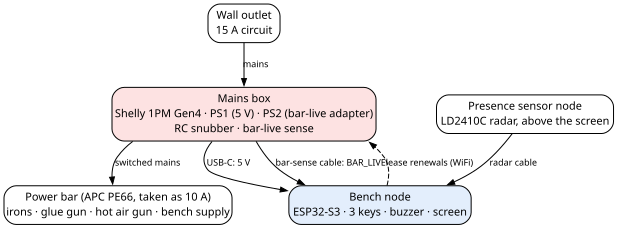

The Deadman Power Protector has three units:

| Unit | Where | What it does |
|---|---|---|
| Mains box | Between the wall outlet and the power bar | Switches the bar with U1, the Shelly 1PM Gen4 smart relay. Feeds the bench node. Senses, on its own, whether the bar is live |
| Bench node | At the bench | An ESP32-S3 devkit (U5) with three keys, a buzzer and a small screen. It decides when to cut, warns, and keeps renewing the Shelly's lease |
| Presence sensor node | Aimed at the bench and its chair | An LD2410C radar (U4) that tells the bench node someone is there |

- The Shelly keeps the bar on only while the bench node keeps renewing a **lease**. If the bench node dies, is
  unplugged or loses the network, the renewals stop and the Shelly turns the bar off by its own timer. How the lease
  works is in the Firmware Gospel, `docs/firmware-gospel.md`.
- Two cables join the mains box to the bench node: a USB-C cable carrying `5VDC` and `GND`, and a 3-pin cable carrying
  the bar-live signal `BAR_LIVE`. One 5-pin cable joins the bench node to the presence sensor node.
- The bar-live sense is a second, independent signal that the bar is live, read from the Shelly's output through an
  optocoupler, so the Shelly is not believed entirely.

## Deadman Power Protector hardware: safety

### Mains is inside the mains box

> **Danger —** The Deadman Power Protector's mains box carries 120 V mains whenever its plug is in the wall. PS1, the
> bench node supply, and the Shelly's own supply are on the unswitched line, so **turning the bar off does not make
> the box safe**. Unplug the box before opening it.

- In this build the mains box enclosure is a 3D-printed box, not a listed electrical box. Mains and low-voltage
  wiring share it, kept at least 3 cm apart, and no wire inside can move.
- **No touchable wire may be at mains potential.** The Shelly's SW input is referenced to mains. Never wire a key, or
  anything outside the mains box, to it. In the Deadman Power Protector, SW is not connected.
- The only path from the mains box to the bench node is the low-voltage side: the USB-C `5VDC` and the output of U2,
  the PC817 optocoupler. Nothing at mains potential leaves the box.
- Changes to a building's fixed wiring are outside this build and need a qualified electrician.

### The switching device has no Canadian mark

U1, the Shelly 1PM Gen4 used here, is the European model, `S4SW-001P16EU`. It carries no Canadian safety mark (no
cUL, cULus, cETLus or CSA). The build uses it anyway; that carries electrical-code and insurance risk.

### What a cut does and does not do

- The Shelly's relay is **non-latching**: it is open whenever its coil is not driven. After a power loss the Shelly
  comes back with the bar **off**.
- There is **no second relay** in series. The Shelly's relay is the only break in the line: the Shelly is judged
  reliable enough on its own. If the Shelly's firmware hangs with its relay on, or its contacts weld shut, the bar
  cannot be cut; the bench node sounds an alarm instead (the alarms are described in the Firmware Gospel).
- **Cutting power does not cool anything.** An iron stays hot for a while after the cut. An iron stand and a smoke or
  heat alarm in the shop still matter.
- There is no OFF key. To stop everything at once, unplug what is in use from the bar. A press of ON held 1.5 s cuts
  the bar (described in the Firmware Gospel, `docs/firmware-gospel.md`, "Deadman Power Protector firmware: the keys and
  LEDs").

### Sizing and protection

- Every mains part is sized to carry 15 A continuously.
- No fuse is drawn or fitted in the mains box's own wiring (whether the Shelly has one inside: "Deadman Power
  Protector hardware: the switching device (U1, Shelly 1PM Gen4)", "Inside the Shelly"). The Shelly switches off
  above its current limit, 15 A, which is a setting of the Shelly (described in the Firmware Gospel).
- The power bar downstream is the weakest part, taken as 10 A (see "Deadman Power Protector hardware: power, loads and
  sizing").

### What must never change in the mains box

1. Every mains part and wire is sized for a full 15 A continuously: 14 AWG, and nothing that lowers that limit.
2. PS1, the bench node supply, is fed **before** the Shelly; PS2, the bar-sense adapter, **after** it. Swapped, the
   bench node dies at every cut, or `BAR_LIVE` reads live while the bar is off.
3. The snubber (R1 and C1) stays from the Shelly's output O to neutral, across the load, and **never across the relay
   contacts**: there it would leak about 4.5 mA into the bar while the bar is off.
4. Nothing is wired to the Shelly's SW terminal. It is at mains potential.
5. Earth runs unbroken from the plug P1 to the receptacle J1.
6. Mains and low-voltage wiring stay at least 3 cm apart, and no wire inside the box can move.
7. The only path from the box to the bench node is the low-voltage side: the USB-C `5VDC` and the optocoupler's
   output. Nothing at mains potential leaves the box.

Every connection and every part value stays as drawn in the schematic, except as "Deadman Power Protector hardware:
substitutes and safe changes" allows.

## Deadman Power Protector hardware: power, loads and sizing

- **Wall circuit:** the Deadman Power Protector is built for a 15 A, 120 V, 60 Hz wall circuit.
- **Sizing rule:** every mains part is sized to carry 15 A continuously, not just the expected load, so the device is
  never what limits the circuit. No part chosen for the mains box may lower the 15 A of the box itself.
- **The power bar** plugs into the device's receptacle J1; it is not part of the device. The bar the design was sized
  against is an APC PE66, taken as 10 A (retailer listings give "1200 Watts at 120V", which is 10 A). So the bar, not
  the device, sets the limit at 10 A, and the bar is accepted as the weak link. The expected load stays under it.
- **Loads:** what is plugged into the bar is not part of the device, and its ratings do not matter to it beyond the
  limits in this section. Loads with a transformer, such as a linear bench power supply, are inductive; they are the reason for
  the snubber (see "Deadman Power Protector hardware: the switching device (U1, Shelly 1PM Gen4)").
- The Shelly's own current limit, 15 A, is a setting (described in the Firmware Gospel).

## Deadman Power Protector hardware: parts

Tolerances are not recorded for any part unless the row gives one. Power ratings of the low-voltage resistors are not
recorded.

### Mains box

| Reference | Function | Part, value and rating | Polarity or orientation |
|---|---|---|---|
| P1 | Mains plug and cord | NEMA 5-15P plug on 14/3 SJT cord | L, N, ground |
| U1 | Switching device | Shelly 1PM Gen4, model `S4SW-001P16EU` (European model); relay 16 A at 240 VAC | Pins 1 to 7, left to right: O, SW, L, L, L, N, N |
| R1 | Snubber resistor | 130 Ω, 5 W, ceramic (cement) body, marked `5W130RJ`. Must have a cement or ceramic body, not a coated film one. Maker: not recorded | None |
| C1 | Snubber capacitor | 100 nF exactly, class X2, marked 275 VAC; no discharge resistor across it. Maker: not recorded | None |
| J1 | Bar receptacle | NEMA 5-15R | L, N, ground |
| PS1 | Bench node supply | 5 V USB charger giving 1 A or more. As built, a brand-name unit sold in Canada with Canadian certification; make, model and marks: not recorded | Pin 1 line in, 2 neutral in, 3 positive out, 4 negative out |
| P3 | Mains box USB-C socket, in the box wall | USB-C, VBUS and GND used; D+ and D− not connected | — |
| PS2 | Bar-sense adapter | JVC AA-R456 AC adapter, 4.5 VDC 600 mA, transformer type (unregulated). No bleeder resistor across it. As built, a brand-name unit sold in Canada with Canadian certification. No-load voltage, and which contact of its plug is positive: not recorded; check the polarity with a meter | Pin 1 line in, 2 neutral in, 3 positive out, 4 negative out |
| U2 | Bar-sense optocoupler | PC817, DIP-4, 5 kV rms isolation. Maker: not recorded | Pin 1 anode, 2 cathode, 3 emitter, 4 collector |
| R2 | Optocoupler LED resistor | 1 kΩ | None |
| D1 | Reverse diode across U2's LED | 1N4148 | Reversed across U2's LED: cathode on U2's anode |
| R3 | `BAR_LIVE` pull-up to `S3_3V3` | 10 kΩ | None |
| C4 | `BAR_LIVE` filter capacitor to ground | 100 nF, 10 V or more | None |
| U11 | Mains box bar-sense header | JST-XH, 3 pins | See "Deadman Power Protector hardware: cables" |
| D3 | Bar-live LED | Green, 5 mm | Anode to R12, cathode on `SENSE_GND` |
| R12 | Bar-live LED resistor | 1 kΩ | None |
| D4 | Reverse diode across D3 | 1N4148 | Reversed across D3: cathode on D3's anode |
| — | Mains joints | Wago connectors (believed to be model 221) | — |

### Bench node

| Reference | Function | Part, value and rating | Polarity or orientation |
|---|---|---|---|
| U5 | ESP32-S3 devkit | YD-ESP32-S3, N16R8 (16 MB flash, 8 MB octal PSRAM), USB-C: "ESP32-S3-DevKitC-1 N16R8, USB-C (YD-ESP32-23 2022-V1.3)". Its IN-OUT jumper is open | Wired by its printed pin names |
| P2 | Bench node USB-C socket | USB-C, wired to U5's native USB-C port by a short pigtail | — |
| C2 | Bulk capacitor on `5VDC` | 100 µF, 25 V, polarized | Pin 1 positive, on `5VDC` |
| C3 | Decoupling capacitor on `5VDC` | 100 nF, 10 V or more | None |
| C7 | Bulk capacitor on `S3_3V3`, at U5's 3V3 pin | 10 µF, 10 V or more, polarized | Pin 1 positive, on `S3_3V3` |
| C8 | Decoupling capacitor on `S3_3V3`, at U5's 3V3 pin | 100 nF, 10 V or more | None |
| U3 | Screen | 0.96" OLED module, 128 × 64, SSD1306 driver, I²C; as built printed "GM009605 v4.2", maker unknown | Wire by its printed pin names (VCC, GND, SCL, SDA); boards differ in pin order |
| SW1 | ON key | Momentary switch with a yellow 3 mm LED; as built, Cherry MX type | Pins 1 and 2 the switch contact; 4 LED anode; 3 LED cathode |
| SW2 | OVERRIDE key | As SW1 | As SW1 |
| SW3 | FN key | As SW1 | As SW1 |
| R4 | ON key LED resistor | 1 kΩ | None |
| R5 | OVERRIDE key LED resistor | 1 kΩ | None |
| R6 | FN key LED resistor | 1 kΩ | None |
| U6 | Radar cable header | JST-XH, 5 pins | See "Deadman Power Protector hardware: cables" |
| U7 | Buzzer cable header | JST-XH, 3 pins | See "Deadman Power Protector hardware: cables" |
| U8 | Bar-sense cable header | JST-XH, 3 pins | See "Deadman Power Protector hardware: cables" |
| U9 | Screen cable header | JST-XH, 4 pins | See "Deadman Power Protector hardware: cables" |
| U10 | Keys cable header | JST-XH, 7 pins | See "Deadman Power Protector hardware: cables" |
| U15 | Screen-end connector of the screen cable | JST-XH, 4 pins | See "Deadman Power Protector hardware: cables" |

### Buzzer board (a small protoboard at the end of the buzzer cable)

| Reference | Function | Part, value and rating | Polarity or orientation |
|---|---|---|---|
| BZ1 | Buzzer | Passive magnetic buzzer (a coil, not a piezo), 11.8 × 8.35 mm, coil about 40 Ω | Pin 1 positive, pin 2 negative |
| Q1 | Buzzer transistor | BC337 NPN, TO-92: 45 V, 800 mA DC, 625 mW, gain 100 or more at 100 mA | The schematic numbers 1 collector, 2 base, 3 emitter; makers differ: find C, B and E with a tester before soldering |
| R7 | Q1 base resistor | 470 Ω | None |
| R8 | Q1 base pull-down | 10 kΩ | None |
| D2 | Buzzer flyback diode | 1N5819 Schottky, 40 V, 1 A | Pin 1 cathode on `5VDC`, pin 2 anode on Q1's collector |

### Presence sensor node

| Reference | Function | Part, value and rating | Polarity or orientation |
|---|---|---|---|
| U4 | Radar | HLK-LD2410C 24 GHz mmWave presence module; supply 5 to 12 V (5 V advised); logic 3.3 V | Pins 1 TX, 2 RX, 3 OUT, 4 GND, 5 VCC |
| C5 | Bulk capacitor on `5VDC` at the radar | 10 µF, 10 V or more, polarized | Pin 1 positive, on `5VDC` |
| C6 | Decoupling capacitor on `5VDC` at the radar | 100 nF, 10 V or more | None |
| U13 | Radar cable header at the sensor node | JST-XH, 5 pins | See "Deadman Power Protector hardware: cables" |

### Cable ends

| Reference | Cable | Kind |
|---|---|---|
| U22, U21 | USB-C power cable, mains box end and bench node end | USB-C plugs |
| U23, U16 | Bar-sense cable, mains box end and bench node end | JST-XH, 3 pins |
| U14, U12 | Radar cable, bench node end and sensor node end | JST-XH, 5 pins |
| U17, U18 | Screen cable, header end and screen end | JST-XH, 4 pins |
| U19 | Keys cable, header end; the other end is soldered to the keys | JST-XH, 7 pins |
| U20 | Buzzer cable, header end; the other end is soldered to the buzzer board | JST-XH, 3 pins |

- **C3 to C8 must be rated 10 V or more.** C3, C5 and C6 sit on `5VDC`; C7 and C8 on `S3_3V3`; C4 on `BAR_LIVE`,
  which never exceeds 3.3 V. C1 is 275 VAC and C2 25 V as drawn. The capacitor types fitted are not recorded and not
  needed.
- **Wire:** all mains wiring is 14 AWG; all low-voltage wiring is 22 AWG.

## Deadman Power Protector hardware: the switching device (U1, Shelly 1PM Gen4)

U1, the Shelly 1PM Gen4, is a smart relay with its own power meter. It switches the power bar on and off, and it runs
the lease script that turns the bar off by itself when the bench node stops renewing. It sits in the mains box, not
inside the power bar.

### Identity and ratings

| Item | Value |
|---|---|
| Product | Shelly 1PM Gen4 |
| Model code | `S4SW-001P16EU` (European model) |
| FCC ID | `2BDC6-1PMGEN4` |
| Supply | 110–240 VAC, 50/60 Hz; or 24–30 VDC |
| Relay rating | 16 A at 240 VAC; 10 A at 30 VDC |
| Operating temperature | −20 °C to 40 °C ambient |
| Firmware | 2.1.0 (described in the Firmware Gospel) |
| Marks | FCC, CE, a μ, a house, a crossed-out bin, a lightning bolt in a triangle. No Canadian safety mark |

- The supply here is 60 Hz, as everywhere on the North American grid; the Shelly is rated 50/60 Hz.

### Inside the Shelly

- **Surge varistor:** a `10D391K` varistor sits between line and neutral. Whether it sits behind a fuse: not
  recorded.
- **The relay:** printed "HF7520 012-HSTP 16A 125VAC, 16A 250VAC, 8A 250VAC (COS ɸ = 0.4), TV-5 SF0816B1". Every
  rating on it is in VAC.
- From the relay maker's datasheet: HF7520/012-HSTP is a 12 VDC coil, one normally open contact (1 Form A), plastic
  sealed, AgSnO2 contacts, high-capacity type.
- **Non-latching.** One coil, two coil pins, and no latching option in the maker's ordering scheme. So the contact
  opens whenever the coil loses drive: a Shelly reset with the coil undriven leaves the bar off.
- How the Shelly's firmware drives the coil after a watchdog reset: not recorded.

### Load types and the snubber

The Shelly's maker lists inductive loads, transformers among them, as supported **only with an RC snubber**. Two
transformer loads can sit on the Shelly's output: a linear bench power supply plugged into the bar, and PS2, the
bar-sense adapter. So the mains box has an RC snubber (R1 and C1) across the Shelly's output. Whether the Shelly has
one inside: not recorded; the maker sells one as a separate accessory.

### Wiring limits of the Shelly's terminals

| Maker document | Wire size | Other limits |
|---|---|---|
| "User and safety guide Shelly 1PM Gen4" | 0.2 to 2.5 mm² (14 AWG at most) | One wire per terminal; insulation rated 105 °C or more |
| The maker's web page | 0.5 to 4 mm² (20 to 11 AWG) | Strip 6 to 7 mm; 0.4 Nm |

The two documents disagree on wire size. **Wire of 0.5 to 2.5 mm² satisfies both.** Use one wire per terminal and
insulation rated 105 °C or more. The Shelly has no earth terminal.

### Not recorded

- The Shelly's current derating at 120 V.
- What the Shelly does when it overheats.

### Documents

- Shelly Knowledge Base, "Shelly 1PM Gen4", https://kb.shelly.cloud/knowledge-base/shelly-1pm-gen4: "Inductive with RC
  Snubber (LED light drivers, transformers, fans, refrigerators, air-conditioners, washing machines, tumble dryers)";
  "Max. switching current: 16A (240 V~)"; "Ambient working temperature: -20 °C to 40 °C"; wire 0.5 to 4 mm².
- Shelly, "User and safety guide Shelly 1PM Gen4",
  https://kb.shelly.cloud/__attachments/a_e65c057158485c88982fe8b3ebb93ff571e6f1e66495eb531888c7e9f809dd93/Shelly%201PM%20Gen%204%20multilingual%20printed%20user%20and%20safety%20guide.pdf.
- Shelly RC Snubber accessory: https://us.shelly.com/products/rc-snubber.

## Deadman Power Protector hardware: the mains box

Schematic box: MAINS BOX, in `hardware/KiCad/Power Protector.kicad_sch`. The mains box sits between the wall outlet and
the power bar. It holds U1 (the Shelly), PS1 (the bench node supply), the snubber R1 and C1, and the bar-live sense.
Its circuits follow in the order of the schematic's boxes.

### Layout

1. The mains box plugs into the wall receptacle by P1, its plug and cord.
2. U1, the Shelly, sits inside the box.
3. The power bar plugs into J1, the box's receptacle, downstream of the Shelly.

### MAINS PLUG IN (P1)

A NEMA 5-15P plug on 14/3 SJT cord. The cord is held by a clamp where it enters the box. In this build there is no
separate strain relief, since the box is not moved; the clamp is part of the enclosure.

### SHELLY 1PM GEN4 (U1)

U1's L terminals take `AC_L`, its N terminals `AC_N`; its output **O** carries the switched line `AC_L_SW`. SW is not
connected. Two `AC_L` wires go to two of its three L terminals (pins 3 and 4); the third (pin 5) is not connected. Two
`AC_N` wires go to its two N terminals (pins 6 and 7).

### RC SNUBBER (R1, C1)

R1, the snubber resistor (130 Ω, 5 W, ceramic or cement body, marked `5W130RJ`), in series with C1, the snubber
capacitor (100 nF X2, marked 275 VAC), as discrete parts. The snubber runs from the Shelly's output (O, `AC_L_SW`)
through R1, then C1, to neutral: **across the load, never across the relay contacts.** R1 must have a cement or
ceramic body, not a coated film one. C1 is exactly 100 nF, with no discharge resistor.

### ALWAYS-ON 5VDC PSU (PS1)

PS1, the bench node supply, is a 5 V USB charger. It is fed from the line **before** the Shelly, so the bench node
outlives a cut. Any 5 VDC supply giving 1 A or more will do. The peak loads on `5VDC` add up to about 0.7 A: the devkit
transmitting on WiFi, about 350 mA (340 mA peak in the ESP32-S3 datasheet); the radar, more than 200 mA; the buzzer
through Q1, about 120 mA; the screen and the three key LEDs, some tens of mA.

### USB-C POWER OUT (P3)

P3, the USB-C socket in the mains box wall. PS1's 5 V and ground go straight to its VBUS and GND; its D+ and D− are not
connected. The USB-C cable to the bench node starts here.

### NEMA 15P RECEPTACLE (J1)

J1, a NEMA 5-15R receptacle, fed by the switched line `AC_L_SW`, neutral `AC_N` and `EARTH`. The power bar plugs in
here.

### 5VDC PSU FOR BAR SENSE (PS2)

PS2, the bar-sense adapter: a JVC AA-R456 AC adapter, 4.5 VDC 600 mA, transformer type. It is wired in **after** the
Shelly (on `AC_L_SW`), so it is fed only while the bar is live, and it powers only U2's LED and D3, the bar-live LED.
**No bleeder resistor is fitted across it**, so it keeps U2's LED lit for a while after a cut. Its output voltage with
no load, and which contact of its plug is positive: not recorded. Check the polarity with a meter and wire its
positive output to `SENSE_5V`.

Substitute for PS2: any unregulated transformer-type AC adapter of about 4.5 VDC that reads no more than about 7 V
with no load, its positive output on `SENSE_5V`. Up to 7 V the LED current of U2 stays about 9× under its limit.

### BAR SENSE

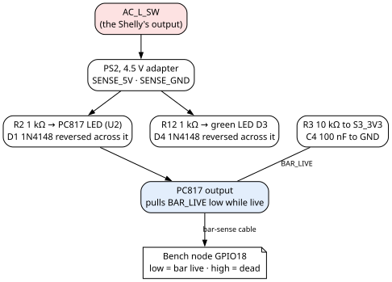

1. PS2 drives the LED of U2, the PC817 optocoupler, through R2 (1 kΩ), with D1 (1N4148) reversed across that LED.
2. U2's output pulls `BAR_LIVE` low while the bar is live.
3. R3, a 10 kΩ pull-up to `S3_3V3`, and C4, a 100 nF capacitor to ground, sit on `BAR_LIVE` at the mains box end, on
   the box's low-voltage side. So `BAR_LIVE` is high when the bar is dead.
4. A 3-pin cable, about 10 ft (3 m) long, joins the mains box and the bench node, carrying `BAR_LIVE`, `GND` and
   `S3_3V3`.

- PS2's side (`SENSE_5V`, `SENSE_GND`) touches nothing else: U2 isolates it from the bench node's side.
- `BAR_LIVE` low means the bar is live.

### BAR LIVE LED (D3)

D3, a green 5 mm LED across PS2's output, in the low-voltage part of the box, with R12 (1 kΩ) in series and D4
(1N4148) reversed across it. Lit, D3 shows that the Shelly's output is live.

### Mains wiring

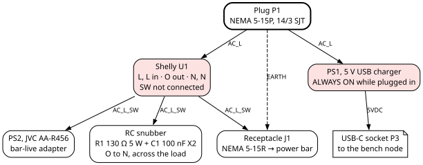

All mains wiring is 14 AWG. As built, joints are made with Wago connectors (believed to be model 221); any connector
that joins the conductors as drawn will do.

| Conductor | Runs to |
|---|---|
| `EARTH` | P1 and J1. Nothing else |
| `AC_L` (line, unswitched) | U1 (two L terminals) and PS1 |
| `AC_N` (neutral) | U1 (two N terminals), PS1, PS2, J1 and the snubber (C1) |
| `AC_L_SW` (switched line, the Shelly's output O) | PS2, J1 and the snubber (R1) |

### Separation

Mains and low-voltage wiring are kept **at least 3 to 4 cm apart** inside the mains box,
and no wire can move. Whether a physical barrier stands between them: not recorded.

### Heat

- The Shelly is rated to 40 °C ambient: the air inside the mains box must stay under 40 °C. The design takes room air
  as about 21 °C usually and 27–28 °C at the warmest, which leaves 12 to 19 °C for the temperature rise inside the box.
- The box air at the bar's 10 A limit: not recorded.

## Deadman Power Protector hardware: the bench node

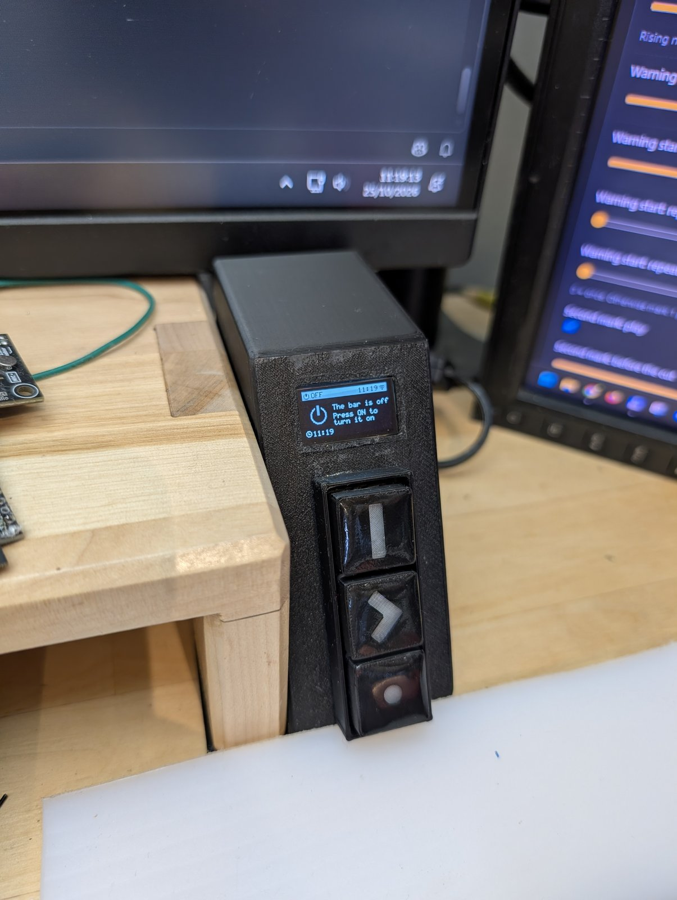

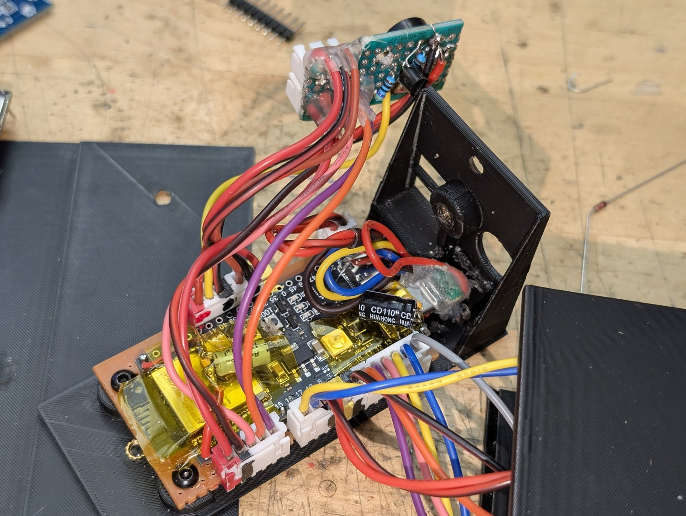

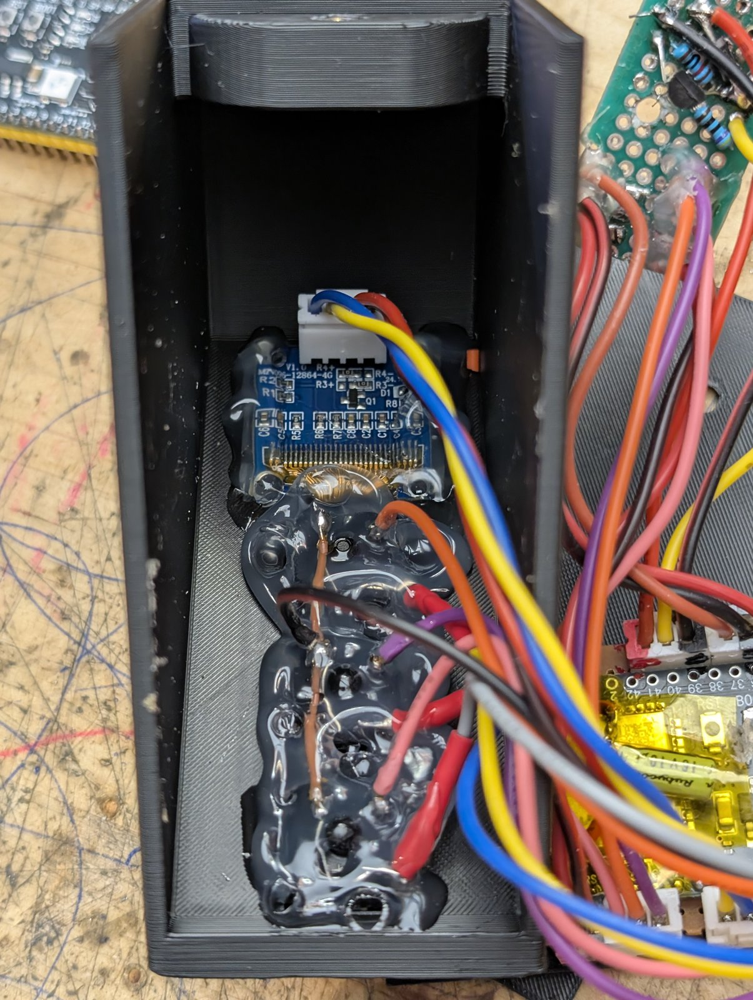

Schematic box: KEYPAD (BENCH NODE). The bench node makes the decisions. It sits at the bench and holds the three keys,
the screen, and the buzzer on its cable. It is joined to the mains box by two cables (USB-C power and the 3-pin
bar-sense cable) and to the presence sensor node by one.

### USB POWER AND DATA IN (P2)

- A **USB-C to USB-C cable** runs from P3, the mains box USB-C socket, to P2, the bench node USB-C socket. It carries
  5 V and ground only.
- P2 feeds U5's **native USB-C port** by a short pigtail: 5 V, ground, and that port's data lines (`USB_DP`,
  `USB_DN`).
- U5's 5V header pin and its second 3V3 header pin are **not connected**.
- **No CC resistors are needed** on either USB-C socket, and the boards fitted carry none. PS1's 5 V is wired straight
  to VBUS and nothing negotiates power, so VBUS is live without them.
- **PS1 must give 5 V DC at 1 A or more.** The peak loads on `5VDC` add up to about 0.7 A.

### MAIN MCU ESP32-S3 N16R8 (U5)

- U5 is an ESP32-S3 devkit, N16R8 (16 MB flash, 8 MB octal PSRAM), with USB-C: the YD-ESP32-S3 board
  ("ESP32-S3-DevKitC-1 N16R8, USB-C (YD-ESP32-23 2022-V1.3)").
- **Its IN-OUT jumper is open.** With the jumper open, the header's 5V pin sits behind a diode on the devkit (marked D3
  on the devkit maker's schematic; not the bar-live LED D3). So U5 is fed through its native USB port, from P2.
- C7 (10 µF) and C8 (100 nF) sit at U5's 3V3 pin.
- As built, U5 sits on headers on a perfboard. Any construction will do, including wires soldered straight to the
  devkit.
- Devkit maker's schematic: YD-ESP32-S3 V1.4,
  https://raw.githubusercontent.com/rtek1000/YD-ESP32-23/main/YD-ESP32-S3-SCH-V1.4.pdf.

### Pins of U5

The same names and numbers are in the pin file, `firmware/bench-node/firmware/src/pins.h`.

| Signal | GPIO | Goes to |
|---|---|---|
| `RADAR_to_S3` | GPIO4 | U4, the radar, its TX |
| `S3_to_RADAR` | GPIO5 | U4, the radar, its RX |
| `RADAR_OUT` | GPIO6 | U4, the radar, its OUT pin |
| `KEY_ON` | GPIO9 | SW1, the ON key |
| `KEY_OVERRIDE` | GPIO10 | SW2, the OVERRIDE key |
| `KEY_FN` | GPIO11 | SW3, the FN key |
| `LED_ON` | GPIO12 | The LED in SW1, through R4 |
| `LED_OVERRIDE` | GPIO13 | The LED in SW2, through R5 |
| `LED_FN` | GPIO14 | The LED in SW3, through R6 |
| `BUZZER` | GPIO15 | Q1's base through R7, on the buzzer board |
| `I2C_SCL` | GPIO16 | U3, the screen |
| `I2C_SDA` | GPIO17 | U3, the screen |
| `BAR_LIVE` | GPIO18 | The bar-live sense in the mains box; low = bar live |

None of these is a strapping, flash, PSRAM or USB pin of the ESP32-S3.

### KEYS (SW1 to SW3)

- **Three momentary switches**, each with a **yellow 3 mm LED**: SW1 ON, SW2 OVERRIDE and SW3 FN. As built they are
  Cherry MX type; any momentary switch will do.
- Each key closes its `KEY_*` line to ground. No pull-up resistor is drawn; the firmware gives each key line an
  internal pull-up of the ESP32-S3 (described in the Firmware Gospel).
- Each key's LED runs from its `LED_*` line through 1 kΩ (R4, R5, R6) to the LED anode (key pin 4); the LED cathode
  (key pin 3) is on ground.
- All six key and LED signals, with ground, share **one 7-pin connector**, U10.

### OLED SSD1306 (U3)

- U3 is a **0.96" OLED, 128 × 64, SSD1306, I²C**, on its own 4-pin cable. It runs on `S3_3V3`. On the schematic its
  symbol is `PP:OLED_0.96_I2C` and its value "0.96in SSD1306, I2C".
- Any 0.96" 128 × 64 SSD1306 I²C module will do; such modules are common, and their colour does not matter.
- Screen boards differ in pin order: the cable must match the board in hand. Wire by the printed pin names.
- Whether the module carries pull-up resistors on SDA and SCL: not recorded. None is drawn.

### MAGNETIC BUZZER AND DRIVER (BZ1, Q1)

- BZ1 is a **passive magnetic buzzer** (a coil, not a piezo), 11.8 × 8.35 mm. Its coil reads about **40 Ω**.
- BZ1 is **driven by Q1, a BC337 NPN transistor** (TO-92), on the buzzer's own small protoboard at the end of the
  3-wire buzzer cable:
  - `BUZZER` (GPIO15) feeds Q1's base through R7 (470 Ω); R8 (10 kΩ) pulls the base to ground.
  - BZ1 runs from `5VDC` (its + lead) to Q1's collector (its − lead). Q1's emitter is on ground.
  - D2, a 1N5819 Schottky diode, sits across BZ1, cathode on `5VDC`, to absorb the coil's turn-off spike.
  - `BUZZER` high turns Q1 on and BZ1 sounds.

> **Caution —** BC337 makers number the leads differently. Find Q1's collector, base and emitter with a tester before
> soldering. The base is the middle lead in every maker's numbering. The schematic numbers them 1 collector, 2 base,
> 3 emitter.

- **Design checks** (from the datasheets, not measured):
  - collector current about (5 V − 0.3 V) / 40 Ω ≈ 120 mA; base current about 5.5 mA, a forced gain of about 22,
    against a minimum gain of 100 for the lowest gain group: Q1 saturates with about 4.5× margin;
  - Q1 dissipates about 30 mW, about 84 mW at the datasheet's 0.7 V worst-case saturation voltage, against 625 mW
    rated;
  - GPIO15 sources about 5.5 mA, under its default 20 mA drive;
  - while U5 resets, GPIO15 floats and R8 holds Q1 off, so BZ1 stays silent through boot;
  - D2 clamps the spike to about 5 V plus its forward drop, well under Q1's 45 V rating.
- Any small passive magnetic buzzer will do; such buzzers are common, and their exact size and rating do not matter. A
  16 Ω coil in place of the 40 Ω one might not saturate Q1 in the worst case and would sound quieter; that is not a
  safety issue.
- **Why a driver:** wired straight from GPIO15, a 40 Ω coil draws about 80 mA, above the pin's rating, and its
  turn-off spike has no diode. Wired that way, the bench node restarts whenever a sound changes pitch while the pin is
  driven.

## Deadman Power Protector hardware: the presence sensor node

Schematic boxes: SENSOR NODE and RADAR LD2410C. The presence sensor node is a small separate unit holding U4, the radar
that tells the bench node someone is there.

- **Sensor:** U4, an HLK-LD2410C 24 GHz mmWave presence module, in its own small node, aimed to see only the bench and
  its chair, and nothing beyond.
- **Cable:** a 5-pin cable to the bench node, about 1.5 m, made from USB-type cable with a foil shield. The shield is
  tied to ground at the bench node end only.
- C5 (10 µF) and C6 (100 nF) sit on `5VDC` at the sensor.
- From the maker's manual: pins 1 TX, 2 RX, 3 OUT, 4 GND, 5 VCC; supply 5 to 12 V (5 V advised); logic at 3.3 V;
  serial port at 256 000 baud by default.
- U4 runs at 5 V, exactly the advised value. Its 3.3 V signals go straight to U5's 3.3 V pins, with no level shifting.
- How the radar is tuned and filtered is firmware (described in the Firmware Gospel).

## Deadman Power Protector hardware: the schematic

- **File:** `hardware/KiCad/Power Protector.kicad_sch`, revision A, KiCad 9. The sheet is A3. Its symbols are in the
  project library `hardware/KiCad/PP.kicad_sym`, so it opens on another computer.
- **Its PDF,** `hardware/KiCad/Power Protector - Schematic.pdf`, is the A3 sheet fitted onto one US Letter page in
  landscape (scaled 0.665). Its smallest text prints at about 2 pt, so read small pin labels on a screen, zoomed.
- **Its bill of materials,** `hardware/Deadman - BoM.csv`, lists the parts of this file and the schematic unit by unit
  (mains box, bench node, sensor node) and for the cables, with quantities and references. It belongs to revision A,
  with the schematic.
- **Title block:** revision "A", date "2026-10-25".
- **SVG export:** `docs/figures/power-protector-schematic.svg`, the whole sheet. One SVG per box of the
  schematic sits beside it, named `docs/figures/schematic-<box>.svg` (for example `schematic-shelly.svg`,
  `schematic-bar-sense.svg`, `schematic-mcu.svg`).
- **KiCad's electrical rules check:** 0 errors, 2 warnings, both "unconnected wire endpoint" on the two short stubs
  marked "Cable S/F" (the cable shields).
- **Connectors:** every header and cable end U6 to U20 and U23 is JST-XH. P1, J1 and the USB-C sockets and cable ends
  (P2, P3, U21, U22) are not JST. The JST connectors are a convenience; any connector that keeps the same connections
  will do.
- **JST pin numbers are a schematic convention.** Each cable end is numbered to match its mating header. Which
  physical pin is pin 1 is left to the builder: choose it on each header, and number its cable end the same way, so
  that pin k meets pin k.
- The schematic is a visual aid; "Deadman Power Protector hardware: every connection" states every connection in words.

## Deadman Power Protector hardware: every connection

This is the Deadman Power Protector's wiring, net by net, as drawn in `hardware/KiCad/Power Protector.kicad_sch`.

### Part pins used in the net tables

- U1, the Shelly, pins 1 to 7, left to right: O, SW, L, L, L, N, N.
- U2, the PC817: 1 anode, 2 cathode, 3 emitter, 4 collector.
- Each key (SW1 to SW3): pins 1 and 2 the switch contact; 4 the LED anode; 3 the LED cathode.
- Polarized capacitors (C2, C5, C7): pin 1 positive.
- Each wall adapter (PS1, PS2): 1 line in, 2 neutral in, 3 positive out, 4 negative out.
- Q1, the BC337: 1 collector, 2 base, 3 emitter, as drawn (find the leads with a tester; makers differ).
- BZ1, the buzzer: 1 positive, 2 negative. D2: 1 cathode, 2 anode.
- U5, the devkit, has, besides its header pins, three pins for its native USB-C port: VBUS, D−, D+.

### Mains nets (14 AWG)

| Net | Every pin on it |
|---|---|
| `AC_L` (line, unswitched) | P1 L; U1 pins 3 and 4 (L, L); PS1 pin 1 |
| `AC_N` (neutral) | P1 N; J1 N; U1 pins 6 and 7 (N, N); PS1 pin 2; PS2 pin 2; C1 pin 2 |
| `AC_L_SW` (switched line) | U1 pin 1 (O); J1 L; PS2 pin 1; R1 pin 1 |
| `EARTH` | P1 ground; J1 ground. Nothing else |
| Snubber middle (no name) | R1 pin 2; C1 pin 1 |
| Not connected | U1 pin 2 (SW); U1 pin 5 (the third L) |

### Bar-sense nets in the mains box (22 AWG)

| Net | Every pin on it |
|---|---|
| `SENSE_5V` (PS2's positive output) | PS2 pin 3; R2 pin 1; R12 pin 1 |
| `SENSE_GND` (PS2's negative output) | PS2 pin 4; U2 pin 2 (cathode); D1 anode; D3 cathode; D4 anode |
| U2 LED anode (no name) | R2 pin 2; U2 pin 1 (anode); D1 cathode |
| D3 anode (no name) | R12 pin 2; D3 anode; D4 cathode |

### Low-voltage nets (22 AWG)

Each net lists every pin on it. Cable ends carry the same signal as the header pin they mate with.

| Net | Every pin on it |
|---|---|
| `5VDC` | PS1 pin 3; P3 VBUS; USB cable ends U22 and U21 VBUS; P2 VBUS; U5 native-port VBUS; C2 pin 1; C3 pin 1; U6 pin 1; U14 pin 1; U12 pin 5; U13 pin 5; U4 pin 5 (VCC); C5 pin 1; C6 pin 1; U7 pin 1; U20 pin 1; BZ1 pin 1 (+); D2 pin 1 (cathode) |
| `GND` | PS1 pin 4; P3 GND; both USB cable ends' GND; P2 GND; U5 GND (two header pins); C2, C3, C4, C5, C6, C7, C8 pin 2; SW1, SW2, SW3 pins 2 and 3; U3 GND; U4 pin 4 (GND); U2 pin 3 (emitter); Q1 pin 3 (emitter); R8 pin 2; U6 pin 2, U7 pin 3, U8 pin 2, U9 pin 2, U10 pin 1, U11 pin 2, U13 pin 4, U15 pin 3, and each of their cable ends' matching pin |
| `S3_3V3` | U5 3V3 (one header pin); C7 pin 1; C8 pin 1; U9 pin 1; U17 pin 1; U18 pin 4; U15 pin 4; U3 VCC; U8 pin 3; U16 pin 3; U23 pin 3; U11 pin 3; R3 pin 1 |
| `BAR_LIVE` | U2 pin 4 (collector); R3 pin 2; C4 pin 1; U11 pin 1; U23 pin 1; U16 pin 1; U8 pin 1; U5 GPIO18 |
| `USB_DP` | P2 D+; U5 native-port D+ |
| `USB_DN` | P2 D−; U5 native-port D− |
| `I2C_SDA` | U5 GPIO17; U9 pin 3; U17 pin 3; U18 pin 1; U15 pin 1; U3 SDA |
| `I2C_SCL` | U5 GPIO16; U9 pin 4; U17 pin 4; U18 pin 2; U15 pin 2; U3 SCL |
| `BUZZER` | U5 GPIO15; U7 pin 2; U20 pin 2; R7 pin 1 |
| Q1 base (no name) | R7 pin 2; R8 pin 1; Q1 pin 2 |
| Q1 collector (no name) | Q1 pin 1; BZ1 pin 2 (−); D2 pin 2 (anode) |
| `KEY_ON` | U5 GPIO9; U10 pin 2; U19 pin 2; SW1 pin 1 |
| `KEY_OVERRIDE` | U5 GPIO10; U10 pin 3; U19 pin 3; SW2 pin 1 |
| `KEY_FN` | U5 GPIO11; U10 pin 4; U19 pin 4; SW3 pin 1 |
| `LED_ON` | U5 GPIO12; U10 pin 5; U19 pin 5; R4 pin 2. R4 pin 1 to SW1 pin 4 (LED anode) |
| `LED_OVERRIDE` | U5 GPIO13; U10 pin 6; U19 pin 6; R5 pin 2. R5 pin 1 to SW2 pin 4 (LED anode) |
| `LED_FN` | U5 GPIO14; U10 pin 7; U19 pin 7; R6 pin 2. R6 pin 1 to SW3 pin 4 (LED anode) |
| `RADAR_to_S3` | U5 GPIO4; U6 pin 3; U14 pin 3; U12 pin 3; U13 pin 3; U4 pin 1 (TX) |
| `S3_to_RADAR` | U5 GPIO5; U6 pin 4; U14 pin 4; U12 pin 2; U13 pin 2; U4 pin 2 (RX) |
| `RADAR_OUT` | U5 GPIO6; U6 pin 5; U14 pin 5; U12 pin 1; U13 pin 1; U4 pin 3 (OUT) |
| Not connected | P3 D+ and D−; both USB cable ends' D+ and D−; U5 5V header pin; U5 second 3V3 header pin; every U5 pin not named in this table |

> **Caution —** The Deadman Power Protector's radar cable is not pin for pin by position: pin 1 at the bench node (U6)
> is `5VDC`, but pin 1 at the sensor node (U13) is `RADAR_OUT`. Follow the net names, not the pin numbers.

## Deadman Power Protector hardware: cables

Six cables join the Deadman Power Protector's units and the parts on the bench node. Each cable end carries, on its pin
k, the same signal as pin k of the header it plugs into. The two ends of one cable are not always numbered alike: on
the radar cable, pin 1 is `5VDC` at the bench node but `RADAR_OUT` at the sensor node. Follow the signal names.

| Cable | From | To | Ends | Length | Kind |
|---|---|---|---|---|---|
| USB-C power | P3 (mains box) | P2 (bench node) | U22, U21 | About 10 ft (3 m), the same distance as the bar-sense cable; exact length is the builder's choice | USB-C to USB-C cable; 5 V and ground only, D+ and D− not carried |
| Bar sense | U11 (mains box) | U8 (bench node) | U23, U16 | About 10 ft (3 m) | Cat7 S/FTP; shield tied to ground at the bench node end only. Which Cat7 conductors carry which signal is the builder's choice |
| Radar | U6 (bench node) | U13 (sensor node) | U14, U12 | About 1.5 m | USB-type cable with foil shield; shield tied to ground at the bench node end only |
| Screen | U9 | U15 (at the screen) | U17, U18 | Under 12 cm | Individual 22 AWG wires |
| Keys | U10 | The keys | U19 | Under 12 cm | Individual 22 AWG wires, soldered straight to the keys and their LEDs |
| Buzzer | U7 | The buzzer board | U20 | Under 12 cm | Individual 22 AWG wires, soldered straight to the buzzer board |

Inside each box, every wire is under 12 cm.

### USB-C power cable (schematic box BENCH NODE TO MAINS BOX)

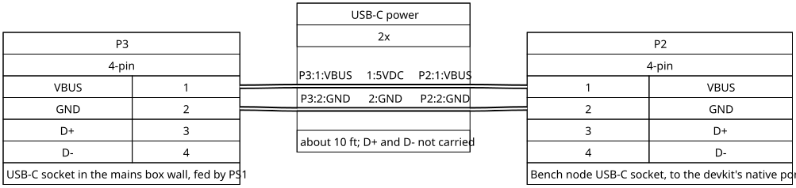

| P3 / U22 (mains box) | Signal | U21 / P2 (bench node) |
|---|---|---|
| VBUS | `5VDC` | VBUS |
| GND | `GND` | GND |
| D+, D− | Not carried | D+, D− |

### Bar-sense cable, 3-pin (schematic box BENCH NODE TO MAINS BOX)

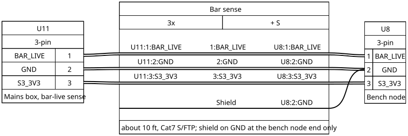

| U11 / U23 pin (mains box) | Signal | U16 / U8 pin (bench node) |
|---|---|---|
| 1 | `BAR_LIVE` | 1 |
| 2 | `GND` | 2 |
| 3 | `S3_3V3` | 3 |
| Shield | Tied to `GND` at the bench node end only | — |

### Radar cable, 5-pin (schematic box BENCH NODE TO LD2410C RADAR)

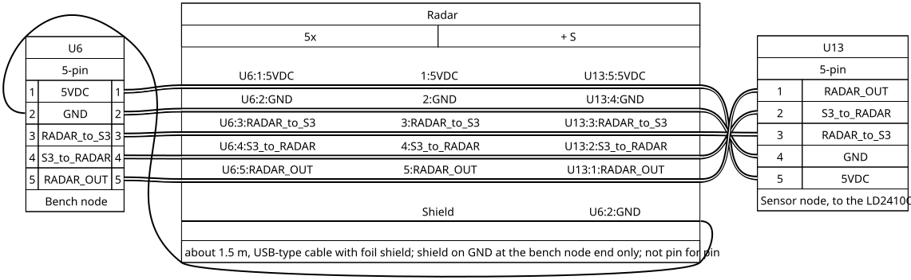

| U6 / U14 pin (bench node) | Signal | U12 / U13 pin (sensor node) | U4 (radar) pin |
|---|---|---|---|
| 1 | `5VDC` | 5 | 5 (VCC) |
| 2 | `GND` | 4 | 4 (GND) |
| 3 | `RADAR_to_S3` | 3 | 1 (TX) |
| 4 | `S3_to_RADAR` | 2 | 2 (RX) |
| 5 | `RADAR_OUT` | 1 | 3 (OUT) |
| Shield | Tied to `GND` at the bench node end only | — | — |

### Screen cable, 4-pin (schematic box BENCH NODE - S3 to OLED)

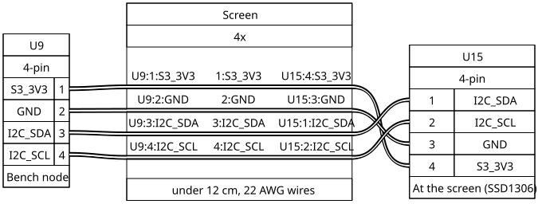

| U9 / U17 pin (bench node) | Signal | U18 / U15 pin (at the screen) |
|---|---|---|
| 1 | `S3_3V3` | 4 |
| 2 | `GND` | 3 |
| 3 | `I2C_SDA` | 1 |
| 4 | `I2C_SCL` | 2 |

### Keys cable, 7-pin (schematic box BENCH NODE - S3 to KEYS and LEDS)

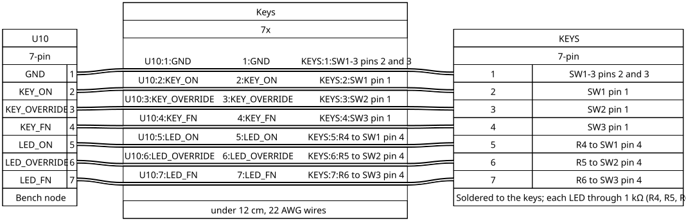

| U10 / U19 pin | Signal | At the keys |
|---|---|---|
| 1 | `GND` | SW1, SW2, SW3 pins 2 and 3 |
| 2 | `KEY_ON` | SW1 pin 1 |
| 3 | `KEY_OVERRIDE` | SW2 pin 1 |
| 4 | `KEY_FN` | SW3 pin 1 |
| 5 | `LED_ON` | R4 to SW1 pin 4 |
| 6 | `LED_OVERRIDE` | R5 to SW2 pin 4 |
| 7 | `LED_FN` | R6 to SW3 pin 4 |

### Buzzer cable, 3-pin (schematic box BENCH NODE - S3 to BUZZER)

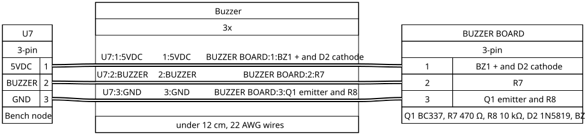

| U7 / U20 pin | Signal | At the buzzer board |
|---|---|---|
| 1 | `5VDC` | BZ1 +, D2 cathode |
| 2 | `BUZZER` | R7 |
| 3 | `GND` | Q1 emitter, R8 |

## Deadman Power Protector hardware: enclosures

The enclosures of the Deadman Power Protector are not part of the build: their form is the builder's choice. The
mains box enclosure must meet these requirements:

- Mains and low-voltage wiring share it, kept at least 3 cm apart, and no wire inside can move.
- PS1 and PS2, the two power supplies, are fixed in place.
- The cord P1 is held by a clamp where it enters the box.
- P3, the USB-C socket, sits in the box wall.
- The air inside must stay under 40 °C, the Shelly's ambient rating.
- D3, the bar-live LED, sits in the low-voltage part of the box.

In this build the mains box enclosure is a 3D-printed box, not a listed electrical box. Its material, and whether a
physical barrier separates mains from low voltage: not recorded. The bench node and the presence sensor node
enclosures carry no recorded requirement, beyond aiming U4, the radar, at the bench and its chair only.

## Deadman Power Protector hardware: substitutes and safe changes

### What a builder may substitute

| Part | May be replaced by |
|---|---|
| The Wago connectors in the mains box | Any connector that joins the conductors as drawn |
| PS1, the bench node supply | Any 5 VDC supply giving 1 A or more |
| PS2, the bar-sense adapter | Any unregulated transformer-type AC adapter of about 4.5 VDC, no more than about 7 V with no load, positive on `SENSE_5V` |
| BZ1, the buzzer | Any small passive magnetic buzzer |
| U3, the screen | Any 0.96" 128 × 64 SSD1306 I²C module; match the cable to its pin order |
| The enclosures | Anything that meets the requirements in "Deadman Power Protector hardware: enclosures" |
| The perfboard and headers under U5 | Wires soldered straight to the devkit |
| The Cherry MX keys | Any momentary switches |
| The JST connectors | Any connector that keeps the same connections |

### What may change, and what each change touches

| Change | Allowed when | It touches |
|---|---|---|
| A signal's GPIO | The new pin is not a strapping pin (GPIO0, 3, 45, 46), not a flash or PSRAM pin (GPIO26 to 37), not the native USB pair (GPIO19, 20), and not already used | The pin file `firmware/bench-node/firmware/src/pins.h` and a firmware rebuild; the schematic; a re-test of that signal's path |
| R2, the optocoupler LED resistor | U2's LED current stays well under 50 mA, and at about 1 mA or more, enough for 0.33 mA out at the lowest transfer ratio | Nothing else |
| R3 and C4, the pull-up and filter on `BAR_LIVE` | The pull-up still goes to 3.3 V | The bar-sense timing the firmware relies on: re-test the bar sense |
| R7 and R8, Q1's base resistors | Q1 still saturates: base current about 1/20 of the buzzer current or more | Nothing else |
| R4 to R6 and R12, the LED resistors | Brightness only | Nothing else |
| Q1, the buzzer transistor | Any small NPN rated 45 V and 0.5 A or more, with a gain of 100 or more at 100 mA. Check its lead order | Nothing else |
| D2, the buzzer flyback diode | Any Schottky or 1N400x-type diode rated 1 A and 40 V or more, cathode on `5VDC` | Nothing else |
| U2, the optocoupler | Any 4-pin phototransistor optocoupler with 5 kV isolation and a transfer ratio of 50 % or more | Nothing else |
| Connectors, enclosures, how the boards are built | Anything that keeps the same connections | Nothing else |

A change on the cut path or the warning path (`BAR_LIVE`, the buzzer, the keys, the screen, the radar, the lease) is
re-tested on that path before the Deadman Power Protector goes back into use.

The list of what must never change in the mains box is in "Deadman Power Protector hardware: safety".

## Deadman Power Protector hardware: building and checks

- **Order of assembly and checks before energizing:** left to the builder.
- **Voltages at each node:** the rails are named for their voltage: `5VDC` (5 V), `S3_3V3` (3.3 V), `SENSE_5V` (PS2's
  output, about 4.5 V nominal, up to about 7 V with no load).
- **Which Cat7 conductors carry which signal, and the USB-C cable's exact length:** the builder's choice.

### Expected values

| Check | Expected | How to check |
|---|---|---|
| `BAR_LIVE` after the Shelly turns off, no load on the bar | Goes dead (high) about 7 s after the Shelly turns off; so a cut that lasts only 5 s before the bar is switched back on never shows as dead | The bench node's console log (described in the Firmware Gospel) |
| `BAR_LIVE` after the Shelly turns on | Goes live (low) within about 13 ms | The bench node's console log |
| `BAR_LIVE` lag with a load on the bar | Not recorded | — |
| D3, the bar-live LED | Lit while the Shelly's output is live | Look at it |
| Shelly internal temperature, one soldering iron (about 0.4 A at 120 V) for an hour or more, room about 23 °C | About 45 °C. That reading is inside the Shelly's case, above the air around it; the box air is taken as under 40 °C | `bar.t` in the bench node's `/api/state`, or `shelly_temp_c` in its MQTT state message (both described in the Firmware Gospel) |
| BZ1 through U5's boot | Silent: R8 holds Q1 off while GPIO15 floats | A design check from the datasheets, not measured |
| KiCad electrical rules check of the schematic | 0 errors, 2 warnings ("unconnected wire endpoint" on the two "Cable S/F" shield stubs) | KiCad 9.0.7 |

## Deadman Power Protector hardware: known problems, maintenance and end of life

### Known problems

| What you see | What it means | Fix |
|---|---|---|
| D3, the green bar-live LED, is lit | PS2 is powered: the Shelly's output is live | — |
| The bar is on but `BAR_LIVE` reads dead at the bench node | A bad crimp on the `BAR_LIVE` wire of the 3-pin bar-sense cable does exactly this | Redo the crimp; then check R3 and U2 |
| `BAR_LIVE` reads live long after a cut | Normal for about 7 s (no bleeder across PS2). Much longer: the Shelly's relay may still be closed | Check the Shelly; the alarm is described in the Firmware Gospel |
| `BAR_LIVE` always reads live (low), even with the bar off | GPIO18 is held to ground. A solder bridge from GPIO18 to ground on the bench node does exactly this | Remove the bridge |
| The bench node restarts when the buzzer changes pitch | BZ1 is not driven through Q1 | On the buzzer board, Q1, R7, R8 and D2 must be fitted |
| BZ1 is silent | Q1's leads may be swapped | Find Q1's collector, base and emitter with a tester |

### Maintenance and end of life

- Maintenance: not recorded.
- End of life: not recorded.

## Deadman Power Protector hardware: pinned tools

| Tool | Version | Use |
|---|---|---|
| KiCad | 9.0.7 (`kicad-cli version`) | Schematic |
| PyMuPDF | 1.28.2 | Fits the schematic's PDF onto one US Letter page; `kicad-cli` exports only at the sheet's own size |

## Deadman Power Protector hardware: datasheet limits

Only the limits of parts used in the Deadman Power Protector, from the makers' documents. They describe the catalogue
part, not a measurement of the one fitted. Where the fitted part's maker is unknown, a representative sheet is named,
and the lowest figure among makers is the one that holds. "As used" figures follow from the schematic. Every part is
used with margin.

### The Shelly's relay, Hongfa HF7520/012-HSTP

From "HF7520 Subminiature Power Relay", Hongfa, 2023 Rev. 1.00 (link: not recorded):

| Item | Value | Page |
|---|---|---|
| Coil, 12 VDC, 1 Form A | Pick-up 9.6 VDC max.; drop-out 1.2 VDC min.; 720 Ω ±10 % | 174 |
| Release time | 5 ms max. at rated voltage | 173 |
| Dielectric strength, coil to contacts | 2500 VAC for 1 min | 173 |
| Safety approvals, UL/CUL file E133481, high-capacity type | "16A 125VAC 85°C HP type"; "13A 125VAC 105°C HP type"; "TV-5 120VAC HP type" | 173 |
| Safety approvals, TÜV, high-capacity type | "16A 250VAC HP type"; "8A 250VAC cosø=0.4 HP type" | 173 |

The relay's printed "16A 125VAC" matches the UL/CUL rating "16A 125VAC 85°C HP type".

### The Shelly 1PM Gen4 (U1)

The Shelly's own limits are in "Deadman Power Protector hardware: the switching device (U1, Shelly 1PM Gen4)":
supply 110–240 VAC 50/60 Hz, relay 16 A at 240 VAC, −20 °C to 40 °C ambient, wire 0.5 to 2.5 mm² with 105 °C
insulation, inductive loads only with an RC snubber.

### The radar, HLK-LD2410C (U4)

From Hi-Link, "HLK-LD2410C Human Presence Motion Module User Manual", V1.00, revised 2022-11-7
(https://naylampmechatronics.com/img/cms/001080/HLK-LD2410C_datasheet.pdf):

| Item | Value | Page |
|---|---|---|
| Pins | "1 UART_Tx, 2 UART_Rx, 3 OUT, 4 GND, 5 VCC" | 7 |
| Supply | "Power input 5~12V（advise 5V）" | 7 |
| Logic | "The module IO output level is 3.3V. The default baud rate of the serial port is 256000" | 8 |
| Supply capacity | "the power supply capacity of the input power supply is required to be greater than 200mA" | 8, §5.1 |
| Supply current | "Average operating current \| 79 mA"; about 130 mA at most (Fig. 11) | 17 |
| Detection | "Detection distance \| 0.75m ~ 6m, adjustable"; "Distance resolution \| 0.75m"; "Detection angle \| ±60°" | 17 |
| Ambient temperature | "-40 ~ 85℃" | 17 |

As used: 5 V, exactly the advised value. Its 3.3 V signals go straight to 3.3 V pins, with no level shifting. The
firmware caps the range well inside 0.75 to 6 m (described in the Firmware Gospel).

### The ESP32-S3 (U5)

| Item | Value | Source |
|---|---|---|
| Strapping pins | "GPIO0, GPIO3, GPIO45, GPIO46 : Strapping pins" | Espressif, "ESP32-S3 Series Datasheet" v2.2, §2.3.5 |
| PSRAM pins (octal PSRAM modules) | "pins IO35, IO36, and IO37 are connected to the Octal SPI PSRAM and are not available for other uses" | Espressif, "ESP32-S3-WROOM-1/-1U Datasheet" v1.8, Table 3-1, note b |
| Flash and PSRAM pins of the N16R8 | GPIO26 to GPIO37: "Do not use the pins connected to in-package flash/PSRAM for any other purposes." | Espressif, "ESP32-S3 Series Datasheet" v2.2, Table 2-14 |
| Default pin drive | "GPIO17 and GPIO18: 10 mA … All other pins: 20 mA." | Espressif, "ESP32-S3 Series Datasheet" v2.2, p. 18, Table 2-1, footnote 5 |
| Strongest pin drive | 40 mA source, 28 mA sink | The same, Table 5-4 |
| Supply | "Allowed input voltage \| -0.3 \| 3.6 \| V"; recommended 3.0 / 3.3 / 3.6 V; "If you use a single power supply, the recommended output current is 500 mA or more." | The same, Tables 5-1 and 5-2 |
| Logic levels at 3.3 V | Input high 0.75 × VDD or more, input low 0.25 × VDD or less; output high 0.8 × VDD or more, output low 0.1 × VDD or less | The same, Table 5-4 |
| Internal pull-up | 45 kΩ typical | The same, Table 5-4 |
| WiFi transmit peak | "802.11b, 1 Mbps, @21 dBm \| 340" mA | The same, Table 5-7 |
| Operating temperature, N16R8 module | −40 to 65 °C | Espressif, "ESP32-S3-WROOM-1/-1U Datasheet" v1.8, Table 1-1 |

As used: GPIO4, 5, 6 and 9 to 18. None is a strapping, flash or PSRAM pin. The heaviest pin load is GPIO15's about
5.5 mA into Q1's base, against the 20 mA default drive.

Documents: Espressif, "ESP32-S3 Series Datasheet" v2.2,
https://www.espressif.com/sites/default/files/documentation/esp32-s3_datasheet_en.pdf; Espressif, "ESP32-S3-WROOM-1 &
ESP32-S3-WROOM-1U Datasheet" v1.8,
https://www.espressif.com/sites/default/files/documentation/esp32-s3-wroom-1_wroom-1u_datasheet_en.pdf. Both addresses
serve the maker's latest edition.

### The 1N5819 (D2)

From onsemi, "1N5817, 1N5818, 1N5819", 1N5817/D Rev. 11, August 2021
(https://www.onsemi.com/pdf/datasheet/1n5817-d.pdf), p. 2: reverse voltage VRRM "40 V"; "Average Rectified Forward
Current … IO | 1.0 | A"; surge IFSM "25 (for one cycle) | A"; forward voltage "0.34 / 0.6 / 0.9 | V" at 0.1 / 1.0 /
3.0 A.

As used (D2, the buzzer flyback diode): 5 V in reverse, 8× under 40 V; about 120 mA at each turn-off of the buzzer
coil, about 8× under 1 A.

### The BC337 (Q1)

| Item | Value | Source |
|---|---|---|
| Lead order | "C(1) B(2) E(3)" | Diotec BC337 datasheet |
| Lead order | Pin 1 emitter, pin 2 base, pin 3 collector | Philips Semiconductors, "BC817; BC817W; BC337", Rev. 05, 2005-01-21, Table 3 (SOT54, the TO-92 body) |
| Minimum gain, lowest group (-16) | 100 at 100 mA | Diotec BC337 datasheet, p. 2 |
| Dissipation | 625 mW | Diotec BC337 datasheet |
| Collector-emitter voltage | 45 V | Diotec BC337 datasheet |
| Lead order, emitter-base voltage, collector current, gain groups, saturation | "1 collector, 2 base, 3 emitter"; VEBO 5 V; IC 800 mA DC; gain groups 16, 25, 40 at 100–250, 160–400, 250–630 (VCE = 1 V, IC = 100 mA); VCE(sat) 0.7 V max at IC = 500 mA, IB = 50 mA | onsemi, "BC337", BC337−FSC/D Rev. 3, April 2024, pp. 1–2; Diotec, "BC337…BC338", version 2026-03-30 (they agree on every figure) |

The Philips sheet numbers the outer leads the other way from onsemi and Diotec, so Q1's collector, base and emitter are
found with a tester before soldering.

Documents: onsemi, "BC337", BC337−FSC/D Rev. 3, https://www.onsemi.com/download/data-sheet/pdf/bc337-fsc-d.pdf;
Diotec, "BC337…BC338", version 2026-03-30, https://diotec.com/tl_files/diotec/files/pdf/datasheets/bc337.pdf;
Philips Semiconductors, "BC817; BC817W; BC337", Rev. 05, 21 January 2005, document number 9397 750 14022, in a
reseller's copy: https://www.handsontec.com/pdf_files/BC337_5.pdf.

As used (Q1, the buzzer transistor): about 120 mA collector current; base current about 5.5 mA through R7 (470 Ω), a
forced gain of about 22 against at least 100 for the lowest group: Q1 saturates with about 4.5× margin. 5 V on the
collector, 9× under 45 V. Dissipation, taking 0.7 V as a worst case: about 84 mW, 7× under 625 mW. VCE(sat) at exactly
120 mA: not given by either sheet.

### The optocoupler, PC817 (U2)

The fitted part's maker is unknown. Sheets: Sharp, "PC817XxNSZ1B Series", Sheet No. OP18002EN, 2018-01-15, p. 4
(https://global.sharp/products/device/lineup/data/pdf/datasheet/PC817XxNSZ1B_e.pdf); Everlight, "EL817 Series",
DPC-0000046 Rev. 20, 2025-01-20 (https://www.everlighteurope.com/custom/files/datasheets/DPC-0000046.pdf); Lite-On,
"LTV-817/827/847 Series", BNS-OD-C131/A4, January 2010, in a distributor's copy
(https://media.digikey.com/pdf/data%20sheets/lite-on%20pdfs/ltv-817_827_847(m,s,s_ta1).pdf).

| Limit | Sheets say | As used | Margin |
|---|---|---|---|
| LED forward current | Sharp "Forward current \| IF \| 50 \| mA"; Everlight 60 mA; Lite-On 50 mA | (4.5 V − 1.2 V) / 1 kΩ (R2) ≈ 3.3 mA; about 5.8 mA if PS2 idles near 7 V | About 9× under 50 mA |
| LED reverse voltage | 6 V on all three | D1 (1N4148), reversed across the LED, limits it to about 1 V | About 6× |
| Transfer ratio | Sharp "Ic \| IF=5mA,VCE=5V \| MIN.2.5 \| – \| MAX.30 \| mA", that is 50 % to 600 % | Needs only 0.33 mA (3.3 V across R3, 10 kΩ) | At the lowest ratio, about 1.6 mA available from 3.3 mA in: about 5× |
| Collector-emitter voltage | Sharp 80 V; Everlight and Lite-On 35 V | 3.3 V at most | About 10× under 35 V |
| Isolation | 5 kV rms on all three (Sharp: "AC for 1 minute") | Between PS2's 4.5 V side and the bench node's 3.3 V | — |

### The 1N4148 (D1, D4)

From onsemi, "1N91x, 1N4x48 … Small Signal Diode", 1N914/D Rev. 6, September 2024
(https://www.onsemi.com/download/data-sheet/pdf/1n914-d.pdf), p. 2: "Maximum Repetitive Reverse Voltage | VRRM | 100 |
V", "DC Forward Current | IF | 300 | mA"; Vishay, "1N4148", document 81857 Rev. 1.6, 2024-11-07
(https://www.vishay.com/docs/81857/1n4148.pdf): VRRM 100 V, IF 300 mA, "Forward voltage | IF=10mA | VF | – | – | 1 | V".

As used: D1 is reversed across U2's LED and D4 across D3, the bar-live LED. In normal use they see PS2's output in
reverse, a few volts: about 14× under 100 V. They conduct only if PS2 is reversed, through 1 kΩ: a few mA, far under
300 mA.

### The screen, SSD1306 module (U3)

A 0.96" module printed "GM009605 v4.2"; its maker is unknown, and no maker states the module's own supply range. For
the chip, Solomon Systech, "SSD1306", Rev. 1.1, April 2008 (https://cdn-shop.adafruit.com/datasheets/SSD1306.pdf):

| Item | Value | Page |
|---|---|---|
| Logic supply | "V_DD \| Logic Supply Voltage \| - \| 1.65 \| - \| 3.3 \| V" | 48, Table 12-1 |
| Logic inputs | High at 0.8 × VDD or more, low at 0.2 × VDD or less | 48, Table 12-1 |
| Absolute maximum supply | "V_DD \| Supply Voltage \| -0.3 to +4 \| V" | 47, Table 11-1 |
| Operating temperature | −40 to +85 °C | 47, Table 11-1 |

As used: U3 runs on `S3_3V3`, at the top of the chip's 1.65 to 3.3 V range and 0.7 V under its 4 V absolute maximum.
Its I²C inputs need 2.64 V for a high; the ESP32-S3 guarantees at least 2.64 V out. The two meet exactly on paper.

### The snubber, R1 and C1

As used: at 120 VAC 60 Hz, C1's 100 nF impedance is about 26.5 kΩ, so about 4.5 mA flows (5.0 mA at 132 VAC, +10 %).
R1 dissipates about 2.7 mW (3.2 mW at 132 VAC): about 0.06 % of its 5 W. At switch-on, if the relay closes at the
voltage peak with C1 empty, about 1.3 A (1.4 A at 132 VAC) flows for a time constant of 13 µs; the energy in R1 is
about 1.4 to 1.7 mJ per closing.

- **C1, 100 nF X2, marked 275 VAC** (maker unknown). Representative sheet: KEMET, "R46, Class X2, 275 VAC, 110°C",
  F3093 (https://content.kemet.com/datasheets/KEM_F3093_R46_X2_275_110C.pdf; the edition it serves carries the same
  texts; the site's certificate may raise a browser warning): "Rated voltage: 275 VAC 50/60 Hz", "X2 CLASS (IEC
  60384-14)", "Self healing properties", −40 to +110 °C. Class X2 is tested to 2.5 kV impulses (Vishay, MKP338 4 X2
  sheet, document 28118, 2024-07-19, §4.13, https://www.vishay.com/docs/28118/mkp3384x2.pdf). As used: 120 VAC across
  a 275 VAC part, about 2.3×.
- **R1, 130 Ω 5 W, ceramic (cement) body, marked "5W130RJ"** (maker unknown). Representative sheet: Yageo, "Cement
  Resistors, SQP Series / NSP Series", 2021-08-12, in a distributor's copy (https://www.farnell.com/datasheets/3689370.pdf;
  Yageo's own newer edition, V.5, carries the same quoted texts:
  https://yageogroup.com/content/datasheet/asset/file/YAGEO-SQP_NSP_DATASHEET), SQP500: "Power Rating at 40 °C | … 5W",
  derated linearly to about half at 155 °C; "Maximum Working Voltage | … 350V"; short-time overload per IEC 60115-1
  4.13, "2.5 times RCWV for 5 sec." (about 31 W for 5 s at 130 Ω, about 156 J); "Flameproof ceramic case"; "Excellent
  pulse load capability." As used: milliwatts steady; each switch-on pulse is about 1/100 000 of that overload test's
  energy. Rapid repeated switching: not evaluated.

### The bar-sense adapter, JVC AA-R456 (PS2)

- No JVC document for the AA-R456 is known. Its label gives 4.5 V DC 600 mA.
- A resale listing, poweradapter.co, "JVC AA-R451 AC Adapter 4.5V 600mA 5.3W Class 2 Transformer" (the sibling model,
  not the fitted one, and not the maker), quotes its label: "AC120V~60Hz 5.3W", "DC4.5V === 600mA", "CLASS 2
  TRANSFORMER" (https://www.poweradapter.co/jvc-aar451-ac-adapter-45v-600ma-53w-class-2-transformer-p-3468.html).
- A plain transformer adapter is unregulated, so with only a few mA drawn it reads above 4.5 V. Its no-load voltage:
  not recorded. The PC817 limits allow up to about 7 V and stay well inside every limit.

## Deadman Power Protector hardware: glossary

| Term | Meaning |
|---|---|
| Bar-live sense | The circuit in the mains box that tells the bench node, independently of the Shelly, whether the bar is live |
| Bench node | The ESP32-S3 unit at the bench that decides when to cut |
| Cat7 | A category of shielded twisted-pair network cable, with four pairs |
| Devkit | The ESP32-S3 development board at the heart of the bench node (U5) |
| HP type | In the relay maker's safety approvals, the high-capacity version of the relay |
| JST-XH | A small 2.5 mm pitch wire-to-board connector |
| Lease | The bench node's repeated permission to the Shelly to stay on; when it stops, the Shelly cuts by itself |
| MOV, varistor | A part that clamps voltage surges |
| Non-latching relay | A relay that opens as soon as its coil stops being driven |
| Optocoupler | A part that passes a signal through light, so its two sides share no wire |
| RC snubber | A resistor and capacitor in series across a load, to tame the spike when an inductive load is switched |
| RCWV | Rated continuous working voltage of a resistor: the voltage that gives its rated power (the square root of power times resistance), capped at its maximum working voltage |
| S/FTP | A cable with each pair foiled and an overall braid |
| Shelly | U1, the Shelly 1PM Gen4 smart relay that switches the bar |
| SW input | The Shelly's switch input, referenced to mains; not connected in the Deadman Power Protector |
| TV-5 | A UL rating for switching tungsten-filament lamp loads, which draw a large current at switch-on; the number is the steady current class, 5 A |
| X2 capacitor | A capacitor rated to sit across mains line and neutral |
